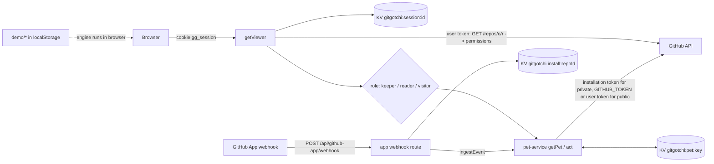

# Accounts: Design

Implements `requirements.md`.

## Why a GitHub App, not an OAuth App

| | OAuth App | GitHub App (chosen) |
|---|---|---|
| Private repo access | `repo` scope: read **and write** to every private repo the user can reach | Read-only, only on repos where the app is installed |
| Webhooks | One manual webhook per repo, secret copied by hand | One app webhook for all installed repos, secret never leaves the server |
| API quota | Per user token | Per installation, grows with the installation; plus the user token |
| Who picks the repos | Nobody, the scope covers all | The installer chooses "all" or "only select repositories" |

GitGotchi App permissions (repository, all **read-only**): Metadata, Contents (commit count on private repos), Actions, Checks, Issues, Pull requests. No account permissions. Webhook events: `push`, `check_run`, `workflow_run`, `pull_request`, `issues`, `repository`, plus `installation` and `installation_repositories`, which every GitHub App receives. "Request user authorization (OAuth) during installation" on, user-to-server token expiry on (8 h, refresh 6 months).

Installing on a repo needs admin on that repo or its org. A collaborator without admin can still sign in and keep a public repo's pet; a private repo needs an admin to install the app once.

## Data flow

## Modules

| File | Role |
|---|---|
| `src/lib/github-app.ts` | App JWT (RS256 from `GITHUB_APP_PRIVATE_KEY`, 9 min), installation token cache (expires 1 h, refreshed at 50 min), `getRepoInstallation(owner, repo)` |
| `src/lib/session.ts` | Create, read, refresh, delete sessions. AES-256-GCM over the user token and refresh token with a key derived from `SESSION_SECRET` (HKDF-SHA256). Session id 32 random bytes, base64url |
| `src/lib/access.ts` | `getViewer(req)` and `roleFor(viewer, repoKey)` returning `keeper`, `reader` or `visitor` plus `visibility`. Caches `{ repoKey, role, at }` in the session for 10 min |
| `src/lib/secrets.ts` | Generate, hash (SHA-256) and constant-time compare badge keys and hook tokens |
| `src/app/api/auth/{login,callback,logout}/route.ts` | User authorization flow. `state` in a short-lived `gg_oauth_state` cookie |
| `src/app/api/github-app/webhook/route.ts` | App webhook. Reuses `toPetEvent` from the existing webhook route (moved to `src/lib/webhook-map.ts`) |
| `src/app/api/pet/[owner]/[repo]/settings/route.ts` | Keeper-only: badge key rotate, hook token create and revoke |
| `src/app/me/page.tsx` | My pets list |
| `src/lib/demo-local.ts` | Browser-side demo store over `localStorage` (`gitgotchi:demo:<name>`), running `state-machine.ts` |

`pet-service.getPet` and `act` gain a `ctx: { role, visibility, token }` argument. Routes resolve `ctx` with `access.ts` before calling them; the service never reads cookies.

## Store keys (Upstash, same client as `pet-store.ts`)

| Key | Value | TTL |
|---|---|---|
| `gitgotchi:pet:<owner/repo>` | existing `PetEntry` plus `repoId`, `visibility`, `badgeKeyHash?`, `hookTokens?: [{ id, hash, createdBy, createdAt }]` | none |
| `gitgotchi:session:<id>` | `{ userId, login, avatarUrl, tokenEnc, refreshEnc, tokenExpiresAt, roles: [...] }` | 30 days, sliding |
| `gitgotchi:install:<repoId>` | `{ installationId, owner, repo }` | none; deleted on uninstall |

Pets are looked up by repo key as today. `repoId` is recorded so a `repository` webhook with action `renamed` can move the entry to the new key, and action `privatized` or `publicized` can update `visibility` (R3.5).

## Request rules

- **Pet GET**: resolve role. Private and role `visitor` gives 404 `repo not found`. Public and no session reads GitHub with `GITHUB_TOKEN` as today.
- **Pet action POST**: needs role `keeper` (session or bound hook token) and, for cookie auth, `Origin` equal to `APP_ORIGIN`. Otherwise 403 `keepers only`. `simulate` stays demo-only and moves to the browser.
- **Badge**: public as today; private needs `k` whose hash matches `badgeKeyHash`, else 404. public badges use the short public cache; the key is never echoed in the SVG.
- **Auto-heal (Summon Kiro)**: private repos need role `reader` or `keeper`; the diagnosis uses the installation token.
- **Webhook (app)**: signature check first, then `gitgotchi:install:<repoId>` must exist, then `ingestEvent`.

## Privacy (R3, R9)

What touches a private repo, and where it goes:

| Data | Source | Kept? | Where | Who can read it |
|---|---|---|---|---|
| Stats, stage, counts, event labels | snapshot, webhook | yes, max 50 events | Upstash, encrypted (`DATA_ENCRYPTION_KEY`) | readers and keepers through the app; the operator with both keys |
| File path of a Kiro hook report | keeper's Kiro hook | yes, inside the event | same | same |
| Webhook body (commit messages, emails, titles) | GitHub | no, parsed and dropped | memory of one request | nobody |
| Diagnosis (failing run names and links, stale issue titles) | GitHub, per request | no | response only | the reader or keeper who asked |
| Repo name | URL, webhook | yes, as the store key and in request logs | Upstash key name, Vercel logs | the operator |
| User token, refresh token | GitHub OAuth | yes, until sign out or 30 days idle | Upstash, encrypted (`SESSION_SECRET`) | the server only |
| Installation token | GitHub App | no, memory cache under 1 hour | function memory | the server only |

Limits that `/privacy` states plainly:

- The operator of the deployment controls the server and both keys, so they can technically read what the app stores. Encryption protects against a leaked store copy or Upstash access alone, not against the operator.
- The repo name is the store key and appears in request URLs, so it is visible in Vercel request logs and the Upstash key list. To hide it as well, key private entries by `repoId` instead; this is optional task 21.
- A private badge URL works for anyone who has it. Keepers rotate the key if a README is copied somewhere public.

## Sign-in host

Chrome's Safe Browsing flagged the OAuth callback on the young custom domain as phishing-like (a page on `lumelo.my.id` receiving a GitHub `code`). Sign in therefore runs on `AUTH_ORIGIN` (`gitgochi.vercel.app`): `/api/auth/login` on the app host redirects there, GitHub calls back there, the callback creates the session and redirects to `APP_ORIGIN/api/auth/handoff?t=<ticket>`. The ticket is 32 random bytes, stored only as a hash for 60 seconds, and works once; the handoff sets the session cookie on the app host and answers with `Referrer-Policy: no-referrer`. No session cookie is set on the sign-in host. `next.config.ts` redirects every other path on the sign-in host to the app host.

## Environment variables (new)

| Variable | Purpose |
|---|---|
| `GITHUB_APP_ID`, `GITHUB_APP_SLUG` | App id for the JWT; slug for the install link `https://github.com/apps/<slug>/installations/new` |
| `GITHUB_APP_PRIVATE_KEY` | PEM private key of the app (multi-line, set as a sensitive variable) |
| `GITHUB_APP_CLIENT_ID`, `GITHUB_APP_CLIENT_SECRET` | User authorization flow |
| `GITHUB_APP_WEBHOOK_SECRET` | Verifies app webhooks |
| `SESSION_SECRET` | 32 random bytes, key material for session encryption |
| `DATA_ENCRYPTION_KEY` | 32 random bytes, encrypts private pet entries (R9.3). Losing it makes those pets unreadable; they re-seed from GitHub |
| `APP_ORIGIN` | `https://gitgochi.lumelo.my.id`, used for the OAuth callback and the `Origin` check |

`GITHUB_TOKEN`, `GITHUB_WEBHOOK_SECRET` and `GITGOTCHI_HOOK_TOKEN` stay for public reads, legacy webhooks and local development.

## Migration

- Existing public pets keep working with no keepers until someone signs in; actions on them become keeper-only when this ships.
- The manual webhook on `Zee7X/gitgochi` keeps working (R4.4). Remove it after the app is installed there, to avoid double events.
- Demo pets already in KV (`gitgotchi:pet:demo/*`) are ignored and can be deleted.
- README: replace "no accounts" and "Public repos only" with the sign-in and private repo rules.

## Testing

- Unit: `session.test.ts` (encrypt round trip, tamper rejected, expiry and refresh), `access.test.ts` (role matrix of R2 and R3 with mocked GitHub answers), `secrets.test.ts`, `github-app-webhook.test.ts` (signature, uninstalled repo ignored), `badge.test.ts` (private key cases), `demo-local.test.ts`.
- E2E (`e2e/`): visitor sees disabled buttons; demo simulator in one browser context does not change another context.
- Manual, recorded in `tasks.md`: sign in on the deployment, install on one public and one private test repo, push to each, check the private pet 404s in a signed-out window and its badge works through camo with `k`.

## Open questions (check before task 8)

- **Keeper check on a public repo the app is not installed on.** Answered 2026-11-19: yes. Signed in as Zee7X before any installation, `/pet/zee7x/gitgochi` showed KEEPER TOOLS, so `GET /repos/{o}/{r}` with a GitHub App user token returns `permissions` for public repos. Installing is only needed for private repos and live webhooks.
- **Deadline.** If the Kiroween deadline is close, ship Phase 1 alone and keep Phases 2 to 4 as planned work in the submission.
