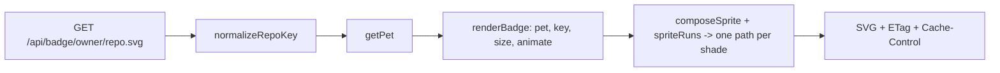

# Haunted UI: Design

Implements `requirements.md`.

## Pages

| Route | File | Content |
|---|---|---|
| `/` | `src/app/page.tsx` | Hero, live `demo/healthy` device, `AdoptForm`, `DemoChips`, `HowItWorks` |
| `/pet/[owner]/[repo]` | `src/app/pet/[owner]/[repo]/page.tsx` | `PetConsole`, `StatsCard`, `EventLog`, `SimulatorPanel`, `BadgeEmbed`, `WebhookSetup` |

## Components (`src/components/`)

| File | Role |
|---|---|
| `RetroShell.tsx` | The handheld case, buttons A/B/C, `haunted` flag while dead |
| `LcdScreen.tsx` | LCD: sprite, stat bars, menu icons, ticker, animations (`die`, `revive`, `eat`, `clean`, `heal`) |
| `PixelSprites.tsx`, `lcd/pixel-maps.ts` | Sprite matrices per stage, poop, icons, `deriveMood`, `composeSprite`, `spriteRuns` |
| `app/PetConsole.tsx` | Wires `usePet` to the shell: menus, effects and sounds, heal modal |
| `app/HealModal.tsx` | SUMMON KIRO modal: findings, COPY PROMPT, focus trap |
| `app/AdoptForm.tsx`, `app/parse-repo.ts` | Input to `/pet/{owner}/{repo}` |
| `app/ErrorCard.tsx`, `app/DemoChips.tsx` | Error states and demo links |
| `app/SimulatorPanel.tsx` | Simulated events (`demo/*` or non-production) |
| `app/BadgeEmbed.tsx`, `app/WebhookSetup.tsx` | Copyable badge markdown and webhook settings |

`src/hooks/usePet.ts`: `GET` on mount, 15 s polling while visible, `POST .../action` (returns the pet even on 409/403), `onStageChange` callback.
`src/lib/audio-synth.ts`: `soundSynth`, square and triangle waves only.

## Badge pipeline

- `src/lib/badge-svg.ts`: `renderBadge`, `renderStatusBadge`, `escapeXml`, `truncate`. One `<path>` per shade, 10-segment bars, monospace text with letter-spacing. The bob uses a `steps(1)` keyframe and respects `prefers-reduced-motion`.
- Why SVG paths and CSS only: GitHub serves README images through a proxy that strips scripts and external resources.
- Why `ETag` from the SVG (a hash of the stats only): unchanged pets answer 304.

## Steering

`.kiro/steering/retro-aesthetic.md` holds the palette, the pixel font (Press Start 2P), the shell and the pixel grid rules; it has no front matter, so Kiro includes it in every request (default inclusion).

## Known limits

- The badge's CSS bob is not verified inside GitHub's proxy yet (`tasks.md` task 6).
- Real-device layout at 390 px was measured on the shell only (340 px wide), not on every page.
