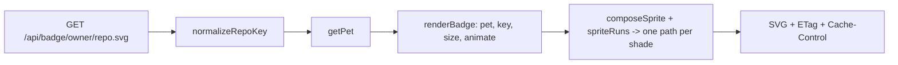

# Haunted UI: Design

Implements `requirements.md`.

## Pages

| Route | File | Content |
|---|---|---|
| `/` | `src/app/page.tsx` | Hero, live `demo/healthy` device, `AdoptForm`, `DemoChips`, `HowItWorks` |
| `/pet/[owner]/[repo]` | `src/app/pet/[owner]/[repo]/page.tsx` | `PetConsole`, `StatsCard`, `EventLog`, `SimulatorPanel`, `BadgeEmbed`, `WebhookSetup` |

## Components (`src/components/`)

| File | Role |
|---|---|
| `RetroShell.tsx` | The handheld case, buttons A/B/C, `haunted` flag while dead |
| `LcdScreen.tsx` | LCD: sprite, stat bars, menu icons, ticker, animations (`die`, `revive`, `eat`, `clean`, `heal`) |
| `PixelSprites.tsx`, `lcd/pixel-maps.ts` | Sprite matrices per stage, poop, icons, `deriveMood`, `composeSprite`, `spriteRuns` |
| `app/PetConsole.tsx` | Wires `usePet` to the shell: menus, effects and sounds, heal modal |
| `app/HealModal.tsx` | SUMMON KIRO modal: findings, COPY PROMPT, focus trap |
| `app/AdoptForm.tsx`, `app/parse-repo.ts` | Input to `/pet/{owner}/{repo}` |
| `app/ErrorCard.tsx`, `app/DemoChips.tsx` | Error states and demo links |
| `app/SimulatorPanel.tsx` | Simulated events (`demo/*` or non-production) |
| `app/BadgeEmbed.tsx`, `app/WebhookSetup.tsx` | Copyable badge markdown and webhook settings |

`src/hooks/usePet.ts`: `GET` on mount, 15 s polling while visible, `POST .../action` (returns the pet even on 409/403), `onStageChange` callback.
`src/lib/audio-synth.ts`: `soundSynth`, square and triangle waves only.

## Badge pipeline

- `src/lib/badge-svg.ts`: `renderBadge`, `renderStatusBadge`, `escapeXml`, `truncate`. One `<path>` per shade, 10-segment bars, monospace text with letter-spacing. The bob uses a `steps(1)` keyframe and respects `prefers-reduced-motion`.
- Why SVG paths and CSS only: GitHub serves README images through a proxy that strips scripts and external resources.
- Why `ETag` from the SVG (a hash of the stats only): unchanged pets answer 304.

## Steering

`.kiro/steering/retro-aesthetic.md` holds the palette, the pixel font (Press Start 2P), the shell and the pixel grid rules; it has no front matter, so Kiro includes it in every request (default inclusion).

## Favicon

`src/app/icon.svg` is the `BABY_GHOST` frame 0 matrix from `lcd/pixel-maps.ts`, drawn as one `<rect>` per horizontal run, with identical runs on consecutive rows merged into taller rects (68 rects, about 3 KB). Rects are grouped in one `<g fill>` per LCD shade over a `#9bbc0f` tile (`rx="4"`); `viewBox="0 1 32 32"` leaves a 1 px margin above and below the sprite. `next build` lists it as the static route `/icon.svg` (served as `image/svg+xml`), and the prerendered `/` head carries `<link rel="icon" href="/icon.svg?icon.<hash>.svg" sizes="any" type="image/svg+xml"/>`. `layout.tsx` sets no `metadata.icons`.

Not added, on purpose (leanest native option):
- `favicon.ico`: browsers that read `<link rel="icon">` never ask for `/favicon.ico`. Only tools that probe the path directly get a 404.
- `apple-icon`: the convention takes only `.png`/`.jpg` or an `ImageResponse` route. iOS "Add to Home Screen" falls back to a page screenshot.
- SVG favicons need Safari 26 or later. Safari 18 and older show the default tab icon.

## Resurrection theme review

The theme is the Kiroween Resurrection category: a 90s virtual pet brought back as a live view of repo health. Checked against `.kiro/steering/retro-aesthetic.md` and the engine:

- Landing (`src/app/page.tsx`): "fed by your commits and killed by red builds. Green CI brings it back from the dead." This matches pet-engine R6: a CI success, a push or a closed issue revives a dead pet, and REVIVE needs the latest CI run to be green. No change.
- Shell (`RetroShell.tsx`): translucent purple egg case, buttons A SELECT / B EXEC / C STATS, `GITGOTCHI` and `KIRO-2026 EDITION` printed on it. It matches the steering. No change. Task 12 later removed the two PCB traces behind the logo and darkened the button labels (see Contrast).
- Dead LCD: the `lcd-dead` class swaps the 4 shades (still the steering palette), the tombstone sprite is shown, the HUD reads `DEAD`, the menu becomes REVIVE / HEAL, and the shell glows (`gg-shell-haunted`). Since task 12 the dead menu bar uses the screen shade instead of s2 (see Contrast).
- Revive flow: a 409 on REVIVE shows a "fix the build, push, then try again" hint, a successful revive plays the `revive` animation (rising ghost and sparkles), and `resurrections` is counted in `StatsCard`. No change.
- Changed: the `metadata.description` in `layout.tsx` said "an MCP auto-heal resurrects it". HEAL only diagnoses and writes a prompt (R2.8), so the description now says a green build brings the pet back.
- Added: `src/app/icon.svg` (R1.6), above.

## Contrast

Tool: `src/lib/__tests__/contrast.test.ts`, part of `npm test` (R4.4). It computes the WCAG 2.x relative luminance and contrast ratio of 125 pairs, with no extra dependency.

- Source check: each pair names the file it is drawn in and the class, CSS declaration or hex it uses (`text-zinc-300`, `outline: 3px solid #fff`, `'#2b2b2b'`). The test asserts that string is still in the file as a whole token, so changing a color fails the test until the pair and this table are updated.
- Colors: Tailwind classes resolve through `tailwindcss/colors` (Tailwind 3 defaults; the config only adds `lcd` and `shell`, which no component uses). LCD colors are parsed from `globals.css` (`:root`, `.lcd-dead`, and the rules that pick a shade: `.lcd`, `.lcd-menu`, `.lcd-dead .lcd-menu`, `.lcd-menu-item-on`, `.lcd-icon-*`, `.lcd-seg*`, `.lcd-f0..3`). Badge colors are read from the SVG that `renderBadge` and `renderStatusBadge` emit. Two more checks: the LCD shades equal the 4 greens in `.kiro/steering/retro-aesthetic.md` (inverted on the dead LCD), and `HealModal.tsx` uses no other hex.
- Translucent colors are composited over what sits behind them: shell gradient stops over the page's `zinc-950`, `zinc-900/80` and `/90` panels over `zinc-950`, `/90` text over its background.
- Shell text is measured at the top of its box, where the background is lightest: the gradient at that height of the 592 px padding box (`h-[600px]` minus `border-4`), plus the specular highlight (`from-white/25`, 16 to 128 px) at its alpha there. That is 40 px for `GITGOTCHI` (`pt-10`) and 61 px for `KIRO-2026 EDITION`. Button labels are measured at both edges of their 16 px `text-xs` line box (14 and 30 px of the 44 px button gradient); the table shows the worse edge.
- Thresholds (WCAG 2.1 AA): text 4.5:1. Press Start 2P is 7 to 15 px and body text 11 to 16 px, so nothing counts as large text. UI boundaries, states, focus outlines and meaningful graphics: 3:1.
- A pair marked as a known limit asserts that it fails, so a fix flips the test and this section gets updated. The LCD text rows also print the grid + scanline worst case in the test name; that value is not asserted.

| Where | Pair (fg on bg) | Ratio | Needs | Result |
|---|---|---|---|---|
| LCD, live (`globals.css`, `LcdScreen.tsx`) | HUD, ticker, stats text s0 #0f380f on s3 #9bbc0f; selected menu item s3 on s0 | 6.02; 6.02 | 4.5 | pass |
| LCD, live | menu text s0 on s2 #8bac0f | 5.03 | 4.5 | pass |
| LCD, dead | HUD, ticker, stats and menu text s0 #9bbc0f on s3 #0f380f; selected item s3 on s0 | 6.02; 6.02 | 4.5 | pass |
| LCD | the text above at the darkest grid + scanline pixel: live text and selected item / live menu / dead | 3.27 / 2.86 / 3.58 | 4.5 | fail, known limit |
| LCD, live and dead | selected icon tile s0 vs screen s3; its glyph s3 on s0 | 6.02; 6.02 | 3 | pass |
| LCD | unselected icon glyph s1 on s3, live / dead | 3.29 / 5.03 | 3 | pass |
| LCD | stat segment on (s0) vs off (s2), live / dead | 5.03 / 3.29 | 3 | pass |
| LCD (`PixelSprites.tsx`) | sprite outline s0 on s3, live and dead; shading s1 on s3, live / dead | 6.02; 3.29 / 5.03 | 3 | pass |
| LCD | sprite highlight s2 on s3, live / dead | 1.20 / 1.83 | 3 | fail, known limit |
| `globals.css` | `gg-btn` / `gg-chip` focus outline #fff on the shell via stop | 13.13 | 3 | pass |
| `RetroShell.tsx` | `GITGOTCHI` #f6efff on shell + highlight at 40 px | 5.24 | 4.5 | pass |
| `RetroShell.tsx` | `KIRO-2026 EDITION` purple-200 on shell + highlight at 61 px | 5.01 | 4.5 | pass |
| `RetroShell.tsx` | button captions and SND, purple-100/90, on the via / bottom stop | 9.26 / 11.22 | 4.5 | pass |
| `RetroShell.tsx` | MUTE rose-300 on the via stop | 6.94 | 4.5 | pass |
| `RetroShell.tsx` | button labels zinc-950 at the worse line-box edge, A amber / B emerald / C rose gradient | 7.73 / 6.64 / 4.91 | 4.5 | pass |
| `RetroShell.tsx` | button borders amber / emerald / rose-300 vs the via stop | 9.10 / 8.61 / 6.94 | 3 | pass |
| `page.tsx` (page zinc-950) | zinc-50 h1 / zinc-100 main / zinc-300 copy / #9bbc0f accent / purple-100 heading | 19.06 / 18.10 / 13.46 / 9.09 / 16.86 | 4.5 | pass |
| `SiteChrome.tsx` | #9bbc0f logo link / zinc-400 footer | 9.09 / 7.76 | 4.5 | pass |
| `AdoptForm.tsx` | purple-100 label / zinc-100 input text / zinc-400 placeholder / rose-300 error | 16.86 / 18.10 / 7.76 / 10.52 | 4.5 | pass |
| `AdoptForm.tsx` | input border purple-600 vs zinc-950 | 3.70 | 3 | pass |
| `ui.tsx` | primary button #0f380f on #9bbc0f (hover #b4d62a); its face #9bbc0f vs page | 6.02 (7.91); 9.09 | 4.5; 3 | pass |
| `ui.tsx`, `DemoChips.tsx` | ghost button and chip label purple-100 on zinc-950 (hover purple-950); chip note zinc-400 | 16.86 (12.71); 7.76 | 4.5 | pass |
| `DemoChips.tsx` | current chip #9bbc0f on #0f380f; its note zinc-400 on #0f380f | 6.02; 5.14 | 4.5 | pass |
| `DemoChips.tsx` | current chip border #9bbc0f vs page (the state) | 9.09 | 3 | pass |
| `ui.tsx`, `DemoChips.tsx` | ghost button and chip border purple-800 vs page | 2.28 | 3 | fail, not required |
| `HowItWorks.tsx` | #9bbc0f heading on page | 9.09 | 4.5 | pass |
| `PetConsole.tsx` | key hints zinc-300; keys amber / emerald / rose-400; hint line amber-200 | 13.46; 11.92 / 10.35 / 7.39; 15.98 | 4.5 | pass |
| `PetConsole.tsx` | tags lime / purple / amber-300; repo name zinc-100; synced zinc-400; #9bbc0f heading | 15.23 / 11.25 / 13.80; 18.10; 7.76; 9.09 | 4.5 | pass |
| `PetConsole.tsx` | key hint `\|` separator zinc-500 | 4.12 | 4.5 | fail, exempt (decoration) |
| `SiteChrome`, `AdoptForm`, `ui`, `DemoChips`, `EventLog`, `BadgeEmbed`, `WebhookSetup` | white focus outline vs page / panel | 19.90 / 18.23 | 3 | pass |
| `ui.tsx`, `HowItWorks.tsx`, `WebhookSetup.tsx` (panel zinc-900/80) | #9bbc0f titles / zinc-100 / zinc-300 / zinc-400 | 8.33 / 16.58 / 12.33 / 7.11 | 4.5 | pass |
| `HowItWorks.tsx`, `EventLog.tsx` | purple-300 step number and KIRO tag on panel | 10.31 | 4.5 | pass |
| `StatsCard.tsx`, `EventLog.tsx` | lime-300 / rose-300 / amber-300 on panel | 13.95 / 9.64 / 12.64 | 4.5 | pass |
| `StatsCard.tsx` | bar fill lime-400 / rose-400 vs zinc-950 track; CI squares lime-400 / rose-400 vs panel | 13.19 / 7.39; 12.09 / 6.77 | 3 | pass |
| `StatsCard.tsx` | bar track border zinc-600 vs panel | 2.36 | 3 | fail, not required |
| `SimulatorPanel.tsx`, `BadgeEmbed.tsx` | zinc-400 intro and label on panel | 7.11 | 4.5 | pass |
| `BadgeEmbed.tsx`, `WebhookSetup.tsx` | snippet and payload URL zinc-200 on zinc-950 | 15.68 | 4.5 | pass |
| `BadgeEmbed.tsx` | snippet textarea border zinc-500 vs panel | 3.77 | 3 | pass |
| `ErrorCard.tsx` (zinc-900/90) | rose-300 / zinc-200 / zinc-400 | 9.51 / 14.17 / 7.01 | 4.5 | pass |
| `HealModal.tsx` | #0f380f on #9bbc0f; on #8bac0f (findings, ESC / CLOSE / COPY PROMPT hover) | 6.02; 5.03 | 4.5 | pass |
| `HealModal.tsx` | #9bbc0f on #0f380f (kind tag, prompt, COPY PROMPT) | 6.02 | 4.5 | pass |
| `HealModal.tsx` | button borders and focus outlines #0f380f vs #9bbc0f; link outline vs #8bac0f | 6.02; 5.03 | 3 | pass |
| `badge-svg.ts` | text, live #0f380f on #9bbc0f / dead #9bbc0f on #0f380f / status #2b2b2b on #c4c4c4 | 6.02 / 6.02 / 8.12 | 4.5 | pass |
| `badge-svg.ts` | bar segment on vs off, live / dead | 5.03 / 3.29 | 3 | pass |

Changed in task 12. The LCD and the modal stay inside the 4 steering greens; the rest of the page uses Tailwind colors.
- `globals.css`: `.lcd-dead .lcd-menu { background: var(--lcd-s3) }`. Dead menu labels were #9bbc0f on #306230 (3.29:1). The bar keeps its 1 px s0 border.
- `HealModal.tsx`: COPY PROMPT hover inverts to #0f380f on #8bac0f (5.03:1), the same hover as ESC and CLOSE, instead of #9bbc0f on #306230 (3.29:1). The scrollable prompt `<pre>` gets the modal's #0f380f focus outline instead of the browser default.
- `RetroShell.tsx`: `KIRO-2026 EDITION` is `text-purple-200` (was `/90`: 4.40:1 under the highlight). Button labels are `text-zinc-950` (with `zinc-900`, label C was 4.38:1 at the bottom of its line box). The two top PCB traces and their pads are gone: they ran behind the logo, where `KIRO-2026 EDITION` over a trace measured 2.84:1 and `GITGOTCHI` over a pad 2.63:1.
- `AdoptForm.tsx`: placeholder `zinc-400` (was `zinc-500`, 4.12:1) and input border `purple-600` (was `purple-800`, 2.28:1). The input has the page's background, so its border is the only thing that shows the field.
- `BadgeEmbed.tsx`: snippet textarea border `zinc-500` (was `zinc-700`, 1.75:1).
- `EventLog.tsx`: the focusable event list gets the white focus outline instead of the browser default.

Known limits, not changed:
- Dot-matrix grid and scanline (required by the steering): a 1 px grid line every 3 px plus the scanline band darken single background pixels. The table's LCD ratios use the solid background color. At the worst pixel (grid intersection under the scanline peak) they drop to 2.86 to 3.58:1.
- Sprite highlight shade: s2 and s3 are the palette's two lightest greens (1.20:1 live, 1.83:1 dead). Every sprite is outlined in s0 (6.02:1), so shapes stay readable.
- Ghost button and demo chip borders (`purple-800`, 2.28:1) and the StatsCard bar track border (`zinc-600`, 2.36:1). 1.4.11 does not require them: the text label identifies each button and chip, and the value is printed above each bar.
- KeyHints `|` separators in `PetConsole.tsx` (`zinc-500`, 4.12:1) are `aria-hidden` decoration, which 1.4.3 exempts. `text-zinc-400` would give 7.76:1.
- Not measured: transient frames (dead-LCD opacity flicker, power flicker, die/revive flash), the 25% ghosting trail, disabled buttons (exempt), the `GITGOTCHI` text shadow, panel and card container borders (decorative), and any in-browser pass (no axe or Lighthouse run). The remaining PCB traces sit behind the opaque bezel and buttons or away from text; that was checked by hand against the layout, not by the test.

## Known limits

- The badge's CSS bob is not verified inside GitHub's proxy yet (`tasks.md` task 6).
- Real-device layout at 390 px was measured on the shell only (340 px wide), not on every page.
- Contrast failures and unmeasured cases are listed under Contrast.
