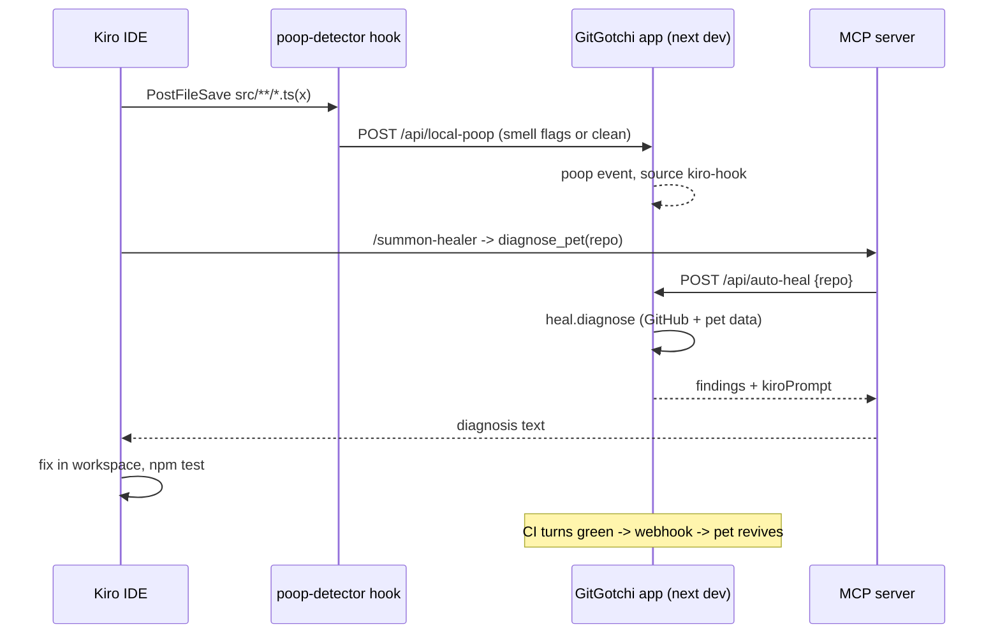

# Kiro Healer: Design

Implements `requirements.md`.

## Flow

## Files

| File | Role |
|---|---|
| `.kiro/hooks/poop-detector.json` | `PostFileSave`, matcher `src[\\/].*\.tsx?$`, command `node scripts/poop-detector.mjs "{{filePath}}"`, timeout 10 |
| `.kiro/hooks/spec-sync.json` | `PostFileSave` on `src/lib/state-machine.ts`, agent prompt: compare with spec, run `npm test` |
| `scripts/poop-detector.mjs` | Scans the file (`console.log(`, `^\s*debugger`, `TODO:`/`FIXME`), POSTs to `/api/local-poop` with a 3 s abort, never fails the hook |
| `src/app/api/local-poop/route.ts` | Localhost-or-bearer gate and parsing; calls `applyHookReport` (`state-machine.ts`), which dedupes per file and removes only the cleaned file's poop (pet-engine R9) |
| `power-gitgotchi/` | Kiro Power (Agent Plugins 1.0.0): `plugin.json`, `mcp.json`, the `summon-healer` skill and a single-file bundle of the MCP server built by `npm run build:power`. Hooks are not part of the Power format and stay in `.kiro/hooks/` |
| `mcp-server/index.mjs` | `McpServer` + `StdioServerTransport`, six tools, ASCII LCD renderer |
| `.kiro/settings/mcp.json` | Registers `gitgotchi`: `node mcp-server/index.mjs`, `GITGOTCHI_URL`, `autoApprove: [get_pet_status, diagnose_pet]` |
| `.kiro/steering/summon-healer.md` | `inclusion: manual`, run as `/summon-healer` |
| `.kiro/steering/kiro-integration.md` | `inclusion: always`; keeps the agent honest about what is wired |
| `src/lib/heal.ts` | `diagnose`, `buildKiroPrompt` |
| `src/app/api/auto-heal/route.ts` | `POST {repo}` returns `{ success, diagnosis }` |
| `src/components/app/HealModal.tsx` | The in-app "SUMMON KIRO" modal: findings as links and a COPY PROMPT button |

## Diagnosis (`src/lib/heal.ts`)

| Finding | Source | Condition |
|---|---|---|
| `ci` | `GET /repos/{key}/actions/runs?status=completed&per_page=1`; falls back to `pet.recentCi` | latest completed run is a failure |
| `issue` | `GET /search/issues?q=repo:{key} is:issue is:open updated:<30d` (max 3) | idle for over 30 days |
| `poop` | stored events with `source: 'kiro-hook'` | only as many as `pet.poopCount`, max 5 |
| `hunger` | `pet.lastPushAt` | no push for 2 days or more |

Each GitHub call returns `null` on failure, so one bad call never kills the diagnosis. Demo repos never call GitHub. `buildKiroPrompt` lists the findings and asks for spec-first work, `npm test`, and an honest report.

## Security notes

- `/api/local-poop` trusts the `Host` and `X-Forwarded-For` headers when no bearer token is set. A remote caller can fake localhost, so set `GITGOTCHI_HOOK_TOKEN` (also read by the hook script) whenever the app is exposed. Marked `shortcut:` in the route.
- `clean` removes all poop, not just the poop of one file. Marked `shortcut:` in the route.

## Environment

| Var | Read by | Purpose |
|---|---|---|
| `GITGOTCHI_URL` | hook script, MCP server | App base URL, default `http://localhost:3000` |
| `GITGOTCHI_REPO` | hook script, local-poop route | Repo key the hook reports to (hook falls back to the git `origin`, route to `demo/healthy`) |
| `GITGOTCHI_HOOK_TOKEN` | hook script, local-poop route | Bearer token for non-local callers |
| `GITHUB_TOKEN` | `src/lib/heal.ts` | GitHub API quota |

## Known limits

- The hook script aborts after 3 s, so the very first hook call against a cold `next dev` (route not compiled yet) is skipped. Open the app once before editing.
- `{{filePath}}` substitution and the stdin key are documented loosely by Kiro; the script falls back to `KIRO_HOOK_FILE` and several stdin keys. Confirm on first run in the IDE.
