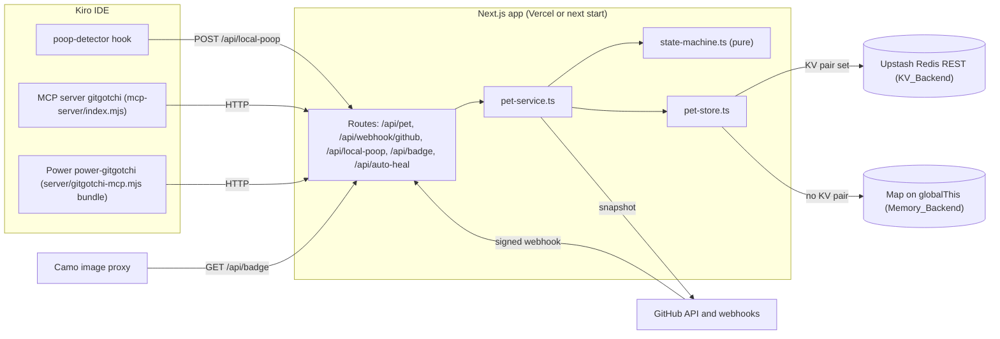

# Design Document: Kiroween Submission

## Overview

This design covers the open parts of `requirements.md` (Requirements 1 to 23) and adds Requirement 24, "zero problems". Status at commit `d6416f9` on `origin/main`:

| Status | Requirements |
|---|---|
| Done | 1.1 to 1.7, 2, 3, 9.1, 9.2, most of 21, favicon (haunted-ui R1.6) |
| In progress in the feature specs | 4 to 6 (github-sync 7), 8 (pet-engine 10), 9.3 (kiro-healer 8), 16 (haunted-ui 12) |
| Open, Agent only | 7, 10, 11.1 to 11.5, 15, 17.1, 17.3 to 17.5, 18, 20.4, 22, 23, 24 |
| Open, gated on the User | 11.6, 12, 13, 14, 17.2, 19, 20.1 to 20.3, 21.2, 21.3, then 1.8 |

Decisions made here:

1. **Deploy:** the User imports `Zee7X/gitgochi` in the Vercel dashboard (vercel.com/new), sets the environment variables there, and Vercel deploys on every push to `main`. The CLI (`npx vercel`) is the fallback, because it hung while downloading.
2. **Webhook:** the User adds it in GitHub, Settings > Webhooks. `gh api` is used only if the User installs and logs in to `gh`.
3. **Camo:** the rendered README is read with an unauthenticated REST request, so Requirement 14 needs no `gh`.
4. **Power:** folder `power-gitgotchi/` at the repository root, carrying a single-file bundle of `mcp-server/index.mjs`.
5. **`tasks.meta.json`:** not committed.
6. **Spec docs:** restructured by inserting or renaming headings only; task lines are never edited.
7. **Lint scope:** `npm run lint` becomes `eslint . --max-warnings 0`, so it checks what the IDE Problems panel shows.

### Changes to requirements.md

These edits go into `requirements.md` before `tasks.md` is written:

- 12.1: the primary path is the dashboard import; the CLI login applies only on the fallback path.
- 13.1 to 13.3: the User creates the webhook in the GitHub UI with the listed URL, content type, secret and events. The `ping` and `push` delivery status codes come from the User reading "Recent Deliveries", or from `gh api` when `gh` is available.
- 14.1: the Camo URL is read from `GET https://api.github.com/repos/Zee7X/gitgochi/readme` with `Accept: application/vnd.github.html`.
- New Requirement 24:

> ### Requirement 24: Zero problems
>
> **User Story:** As the User, I want the IDE Problems panel to be empty, so that judges who open the repository in Kiro see no errors or warnings.
>
> #### Acceptance Criteria
>
> 1. WHEN a spec document under `.kiro/specs/` is created or changed, THE Agent SHALL run `validate_spec_format` on it and fix every error and warning it reports.
> 2. WHEN the Agent restructures a Feature_Specs `tasks.md`, THE Agent SHALL keep the text, number, indentation and order of every task line unchanged.
> 3. THE Agent SHALL make `npx tsc --noEmit` exit with code 0 and print no diagnostics.
> 4. THE Agent SHALL make `npm run lint` lint the whole repository and report 0 errors and 0 warnings.
> 5. WHEN the Agent reports the work as done, THE Agent SHALL have run `validate_spec_format` on all 15 spec documents, `npx tsc --noEmit`, `npm run lint` and `npm test` in this session, and report each result as returned.

## Architecture



Work order:

| Wave | Work | Gate |
|---|---|---|
| 1 | Req 7 replay, Req 10 per-file poop, Req 11.1 to 11.5 Power, lint scope, `.gitignore` | none |
| 2 | Req 24 spec restructure (after the four in-progress tasks finish), Req 15 E2E, Req 17.1/17.3/17.4 media, Req 18 review, Req 22 | none |
| 3 | Req 12 deploy, Req 13 webhook, Req 14 Camo, Req 17.2, Req 11.6, Req 19, Req 20 | User |
| 4 | Req 21.10 links, Req 23 and 24.5 validation, Req 1.8 final push | none |

## Components and Interfaces

### Pre-snapshot replay (Req 7)

New pure function in `src/lib/state-machine.ts`:

```ts
/** Replays logged webhook events onto a freshly seeded pet. `log` is newest first. */
export function replayWebhookEvents(seeded: PetState, log: PetEvent[], now: number): PetState;
```

- Selects events with `source === 'github'`, no `simulated`, and type `pr_merged`, `issue_opened` or `issue_closed`. Skips `push`, `ci`, `death`, `revive` and `sync` (7.3).
- Applies them oldest first with `applyEvent(s, { type }, now, { source: 'github' })`. It uses `now`, not the event time, because the seeded pet's `updatedAt` is `now` and `tick` must not run backwards.
- After each replayed `pr_merged` it sets `partyUntil = event.at + HOUR`. A final `tick(s, now)` clears PARTY when that time has passed and derives the mood again (7.4).

`pet-service.ts` `refresh` calls it when `prior` is a Placeholder_Entry (`prior.snapshotAt === 0 && prior.source === 'github'`). The written log stays `[SYNCED WITH GITHUB, ...prior.events]`; the replay adds no log entries (7.5). The written entry has `snapshotAt = now`, so no later resync treats it as a placeholder again (7.6). github-sync R4.8 and its design change in the same commit (7.7).

### Per-file poop removal (Req 10)

`PetEvent` gains an optional `file` (see Data Models). New pure functions in `src/lib/state-machine.ts`:

```ts
/** Files with an Outstanding_Poop, newest first. `events` is newest first. */
export function outstandingPoops(events: PetEvent[]): string[];

/** One poop-detector report. `event` is null when nothing changes. */
export function applyHookReport(
  pet: PetState,
  events: PetEvent[],
  report: { filePath: string; smell: 'console.log' | 'debugger' | 'TODO' | null },
  now: number,
): { state: PetState; event: PetEvent | null };
```

`outstandingPoops` walks the log from newest to oldest:

- A `clean` event without `file` (the user CLEAN action) or any `revive` event ends every older poop (10.4).
- A `clean` event with `file` ends the older poops of that file only (10.2).
- A `poop` event with source `kiro-hook` and a `file` is outstanding unless ended.

`applyHookReport`:

| Report | Pet | Result |
|---|---|---|
| dirty, file not outstanding | alive | `applyEvent(poop)`; event gets `file` and label `{smell} in {file}` |
| dirty, file outstanding | any | no change (10.6) |
| dirty | dead | no change (the engine returns empty deltas) |
| clean, file outstanding | alive | Poop `max(0, poop - 1)`, Sanity `min(100, sanity + 12)`, event `clean`, source `kiro-hook`, `file`, label `clean after {file}` (10.1, 10.3) |
| clean | dead, or file not outstanding | no change (10.5) |

`src/app/api/local-poop/route.ts` keeps auth, parsing and the 503 mapping and calls `applyHookReport`. Its `hasOutstanding` helper and the full-clean shortcut are removed. `src/lib/heal.ts` `poopFindings` takes `outstandingPoops(events).slice(0, 5)` and titles each finding from that file's newest poop event (10.7). The rule is added to `.kiro/specs/pet-engine/requirements.md` as a new requirement R9 (appending avoids renumbering), and kiro-healer R1.3, R2.3 and `.kiro/steering/kiro-integration.md` are updated (10.8).

### Kiro Power (Req 11)

```
power-gitgotchi/
├── plugin.json
├── mcp.json
├── server/gitgotchi-mcp.mjs      # generated by npm run build:power, committed
└── skills/summon-healer/SKILL.md
```

Why the server is bundled inside the folder:

- The Agent Plugins 1.0.0 `mcp.json` schema allows `cwd` only as `./`, `${PLUGIN_ROOT}` or `${PLUGIN_DATA}` and checks containment, so the Power cannot point at `../mcp-server/index.mjs`.
- A Power copied by "Import power from a folder" or installed from GitHub has no `node_modules`, and the server imports `@modelcontextprotocol/sdk` and `zod`.
- `npm run build:power` runs `rolldown mcp-server/index.mjs --platform node --format esm --file power-gitgotchi/server/gitgotchi-mcp.mjs` (confirm the flags with `npx rolldown --help`). rolldown 1.2.19 is already installed through vite 8. It is added as an explicit devDependency at that version so the script does not rely on a transitive package.
- `mcp-server/index.mjs` stays the only source and the workspace server in `.kiro/settings/mcp.json`.

Rejected: moving the server into the Power and resolving packages from the parent `node_modules` (fails once Kiro copies the folder); a hand-written server without the SDK (a rewrite, and the architecture steering names the SDK); `npx github:Zee7X/gitgochi` (installs the whole Next.js app).

`plugin.json` (schema `additionalProperties: false`, so only these keys):

```json
{
  "$schema": "https://agent-plugins.org/schemas/1.0.0/plugin.schema.json",
  "name": "gitgotchi",
  "version": "1.0.0",
  "description": "Diagnose and heal a GitGotchi repo pet from Kiro: pet status, findings, feed, clean and the summon-healer skill.",
  "author": { "name": "Rizick", "url": "https://github.com/Zee7X" },
  "keywords": ["gitgotchi", "repo pet", "repo health", "summon healer", "code smell", "failing ci"],
  "repository": "https://github.com/Zee7X/gitgochi",
  "license": "MIT"
}
```

`mcp.json`:

```json
{
  "$schema": "https://agent-plugins.org/schemas/1.0.0/mcp.schema.json",
  "mcpServers": {
    "gitgotchi": {
      "type": "stdio",
      "command": "node",
      "args": ["server/gitgotchi-mcp.mjs"],
      "cwd": "${PLUGIN_ROOT}",
      "env": { "GITGOTCHI_URL": "http://localhost:3000" }
    }
  }
}
```

- The workspace-only keys `disabled` and `autoApprove` are left out because the schema rejects them.
- If the import shows that `cwd` is ignored, the fallback is `"args": ["${PLUGIN_ROOT}/server/gitgotchi-mcp.mjs"]`. The result the User reports goes into the Kiro_Usage_Doc (11.6).
- Kiro namespaces the server as `power-gitgotchi-gitgotchi`. In this workspace the User disables one of the two servers so the tools are not listed twice.

`SKILL.md` has frontmatter `name: summon-healer` and a `description`, and a body with the four steps of `.kiro/steering/summon-healer.md`, naming the MCP tools. Hooks stay in `.kiro/hooks/`; the Kiro_Usage_Doc says hooks are not part of the Power format (11.5). ESLint ignores `power-gitgotchi/server/**`. `tsconfig.json` includes only `.ts` and `.tsx`, so the bundle is not type-checked.

### Deployment, webhook and Camo (Req 12 to 14)

| Step | Who | How | Recorded |
|---|---|---|---|
| Store | User | Vercel project, Storage, Upstash Redis (Marketplace), or the Upstash console | which variable names exist (names only) |
| Import | User | vercel.com/new, Import `Zee7X/gitgochi`, framework Next.js, default build | Production_Domain |
| Variables | User | Settings, Environment Variables, Production: `GITHUB_TOKEN`, `GITHUB_WEBHOOK_SECRET`, the KV pair if the integration did not inject it, optional `GITGOTCHI_HOOK_TOKEN`; then Redeploy | names listed |
| Smoke | Agent | `Invoke-WebRequest` on the four URLs of 12.4 | status, `Content-Type`, `source`, `error` |
| Persistence | Agent | `POST /api/pet/zee7x/gitgochi/action` `{"action":"feed"}`, push a commit, wait for the auto-deploy, `GET` again | the feed event id before and after (12.5) |
| Webhook | User | GitHub, Settings, Webhooks, Add webhook: `https://{Production_Domain}/api/webhook/github`, `application/json`, the secret, events push, check runs, workflow runs, pull requests, issues | `ping` status from Recent Deliveries |
| Push test | Agent, User | Agent pushes a commit; User reads the `push` delivery (or `gh api repos/Zee7X/gitgochi/hooks/{id}/deliveries`) | status, and whether `GET /api/pet/zee7x/gitgochi` lists a `push` event from `github` |
| Camo | Agent | `Invoke-WebRequest https://api.github.com/repos/Zee7X/gitgochi/readme -Headers @{ Accept = 'application/vnd.github.html' }`, extract the `camo.githubusercontent.com` URL of the badge, request it | status, `Content-Type`, `@keyframes` present |

- The User generates the webhook secret locally and pastes the same value into Vercel and GitHub. The Agent never sees, types or stores a secret value (12.3, 13.2).
- CLI fallback: `npx vercel login`, `npx vercel link`, `npx vercel env add NAME production` (the value is typed at the prompt, not in the command), `npx vercel --prod`.
- After the domain is known: replace `YOUR-DEPLOYMENT` (12.6) and document the four KV variables (12.7).

### Browser pass and media (Req 15, 17)

- `playwright.config.ts`: `testDir: 'e2e'`, `webServer` runs `npm run build && npm run start -- -p 3100` (port 3100 so it does not collide with `npm run dev` on 3000), `use.baseURL: 'http://localhost:3100'`. Project `e2e` runs `*.spec.ts` at 390x844 and 1280x800; project `media` runs `media.capture.ts`.
- `e2e/fixtures.ts`: an extended `test` that fails on console messages of type `error` or `warning` and on `pageerror` (15.6).
- `e2e/layout.spec.ts` (15.2) and `e2e/keyboard.spec.ts` (15.3 to 15.5).
- `e2e/media.capture.ts`: `hero.png`, `zombie.png`, `summon-kiro.png` from the Production_Server (no dev indicator, 17.4); `badge.png` from the GitHub repository page when the Camo check passed, else from `/api/badge/demo/healthy` with a README caption that says so (17.2, 17.3).
- Scripts: `"test:e2e": "playwright test --project=e2e"`, `"media": "playwright test --project=media"`, `"build:power"` as above, `"lint": "eslint . --max-warnings 0"`. `vitest.config.mts` already limits `npm test` to `src/**/*.test.ts` (15.7).
- `.gitignore` adds `/test-results/`, `/playwright-report/`, `/blob-report/` and `/playwright/.cache/`. Browsers are installed once with `npx playwright install chromium`.
- Before touching Next.js config or `next start` usage, the Agent reads the matching guide in `node_modules/next/dist/docs/` (23.1).

### Spec document restructure and zero problems (Req 24)

Validator rules, found by running `validate_spec_format` on copies of the old docs in a temp folder:

- `requirements.md`: H1 exactly `# Requirements Document`; `## Introduction` required; `## Glossary` recommended. The existing `### R1.` headings and `Acceptance criteria:` lists pass as they are.
- `design.md`: any H1. Required: `## Overview`, `## Architecture`, `## Components and Interfaces`, `## Data Models`. Recommended: `## Correctness Properties` with at least one `### Property N: title` heading, each followed by `**Validates: Requirements X.Y**` with numeric IDs (`R7.4` is rejected, `7.4` passes), `## Error Handling`, `## Testing Strategy`.
- `tasks.md`: H1 `# Implementation Plan: {name}`; `## Overview`, `## Tasks`, `## Task Dependency Graph` with a fenced `json` block `{"waves": [{"id": 0, "tasks": ["1", "2"]}]}`, and `## Notes`. Task lines with `[x]`, `[ ]` and `[-]` pass unchanged.

| Doc (x4) | Edit |
|---|---|
| `requirements.md` | H1 becomes `# Requirements Document`. The old title and the existing intro paragraph go under `## Introduction`. haunted-ui gets a `## Glossary` of the terms its criteria use. R numbers stay, so references such as github-sync R4.8 and kiro-healer R1.3 still hold. |
| `design.md` | H1 stays. Existing `##` sections move under the seven required headings as `###`: flow and modules under Architecture or Components and Interfaces, attributes and environment under Data Models, known limits and security notes under Error Handling, testing under Testing Strategy. Correctness Properties: pet-engine lists P1 to P7 as `### Property N:` headings; github-sync, kiro-healer and haunted-ui list the properties their existing tests already check. Section text is unchanged apart from heading levels. |
| `tasks.md` | H1 becomes `# Implementation Plan: {Spec Name}`. `## Overview` (one or two sentences) and `## Tasks` go above the first task line; `## Task Dependency Graph` and `## Notes` go after the last. Waves list every top-level task id as a string: done tasks in wave 0, open tasks in later waves following their "needs" text. Blocked notes (22.3) go into `## Notes` as `Task N: blocked, needs {step}`, so no extra line sits under a task. |

- Other agents are writing checkbox states into these files now. The restructure starts after github-sync 7, pet-engine 10, kiro-healer 8 and haunted-ui 12 finish. Each file is read right before its edit, and edits use `str_replace` on headings and insertion points only, never a full-file write.
- Task-line guard: before editing, save the lines matching `^\s*- \[.\] ` from each `tasks.md`; after editing, compare them with the status character masked. Any difference reverts that file's edit.
- ESLint: `globalIgnores` adds `power-gitgotchi/server/**`, `playwright-report/**`, `test-results/**` and `coverage/**`, so `eslint .` covers `src/`, `mcp-server/`, `scripts/`, `e2e/` and the config files.
- TypeScript: `npx tsc --noEmit` already covers `**/*.ts(x)`, which will include `e2e/` and `playwright.config.ts`.
- JSON: the IDE validates `plugin.json` and `mcp.json` against their `$schema`; the files above use only schema keys.

### tasks.meta.json

Not committed. `.gitignore` gets `.kiro/specs/*/tasks.meta.json` after the `!.kiro/**` line, because git applies the last matching pattern. The files hold execution IDs, chat session IDs and timestamps, change on every task run, and a clone does not need them: task status is in the `tasks.md` checkboxes. `.kiro/specs/kiroween-submission/.config.kiro` stays tracked because it records the spec's workflow type.

### Docs, specs and steering (Req 19 to 22)

- The Kiro_Usage_Doc gets dated Observed_Results for hooks, MCP tools, `/summon-healer`, Correctness view and the Power import. The first-hand questions go to the User in one message (20.2).
- `.kiro/steering/architecture.md`: the project tree adds `power-gitgotchi/`, `e2e/` and the KV_Backend. `.kiro/steering/kiro-integration.md`: KV variables, the Power, per-file poop and the 503 `store unavailable` answer.
- `.kiro/specs/gitgotchi-prd.md` section 2.5 follows the Observed_Results (22.6).

## Data Models

`PetEvent` (`src/lib/types.ts`) gains one optional field. The API response shape `{ pet, events, source, fetchedAt, error? }` is unchanged.

```ts
export interface PetEvent {
  // ...existing fields
  /** Set only on kiro-hook `poop` and per-file `clean` events. Max 200 chars, control characters stripped. */
  file?: string;
}
```

| Model | Shape |
|---|---|
| Placeholder_Entry | `PetEntry` with `snapshotAt === 0` and `source === 'github'` |
| KV record | key `gitgotchi:pet:{owner}/{repo}`; value `JSON.stringify(PetEntry)` with at most 50 events; Upstash REST `POST {url}` with body `["GET", key]` or `["SET", key, value]`, `Authorization: Bearer {token}`, 5 s timeout |
| Hook report | `{ filePath, smell }` built from the existing `POST /api/local-poop` body; `clean: true` gives `smell: null` |
| Task graph | `{ "waves": [ { "id": number, "tasks": string[] } ] }` in a fenced `json` block |
| Power manifests | `plugin.json` and `mcp.json` as shown above |

Environment variables: `UPSTASH_REDIS_REST_URL`, `UPSTASH_REDIS_REST_TOKEN`, `KV_REST_API_URL`, `KV_REST_API_TOKEN`, `GITHUB_TOKEN`, `GITHUB_WEBHOOK_SECRET`, `GITGOTCHI_HOOK_TOKEN` (Vercel), and `GITGOTCHI_URL`, `GITGOTCHI_REPO` (local hook and MCP).

## Correctness Properties

*A property is a characteristic or behavior that should hold true across all valid executions of a system: a formal statement about what the system should do. Properties connect the human-readable requirements to machine-checked guarantees.*

### Property 1: Store round trip keeps the newest 50 events

For any `PetEntry` with 0 to 120 events and either backend, `setEntry` followed by `getEntry` from a fresh module instance (the KV_Backend through a mocked `fetch` backed by a `Map`) returns the entry with `events` equal to the input's first 50.

**Validates: Requirements 4.5, 4.7**

### Property 2: Unparseable KV values count as no entry

For any KV value that is not a JSON object with an object `pet` and an array `events`, `getEntry` resolves to `undefined`.

**Validates: Requirements 4.9**

### Property 3: KV secrets stay in the header

For any KV URL, token and failure mode (network error, non-2xx status, `error` field, timeout), every `fetch` call goes to the configured URL with the token only in `Authorization: Bearer`, and the rejected Store_Error message contains neither the URL nor the token.

**Validates: Requirements 4.8, 5.1, 5.6**

### Property 4: Replay equals an oldest-first fold

For any seeded pet and any placeholder log, `replayWebhookEvents` returns the same stats as applying the log's `github` events of type `pr_merged`, `issue_opened` and `issue_closed` oldest first with `applyEvent` at `now`.

**Validates: Requirements 7.2**

### Property 5: Push and CI events are not replayed

For any placeholder log, adding or removing `push` and `ci` events leaves the result of `replayWebhookEvents` unchanged.

**Validates: Requirements 7.3**

### Property 6: Replayed PARTY ends one hour after arrival

For any placeholder log whose newest `pr_merged` arrived at time `t`, the replayed pet's mood is PARTY exactly when the pet is alive and `now < t + 1 hour`.

**Validates: Requirements 7.4**

### Property 7: Replay runs once and logs once

For any placeholder log, seeding through `getPet` stores the log `[SYNCED WITH GITHUB, ...log]`, and a forced resync of that entry with the same snapshot applies no replayed event.

**Validates: Requirements 7.5, 7.6**

### Property 8: The engine sets only six moods

For any sequence of events, actions and ticks, the pet's `mood` is one of `DEAD`, `PARTY`, `SICK`, `HUNGRY`, `DIRTY` or `HAPPY`.

**Validates: Requirements 8.1**

### Property 9: Per-file poop follows a set model

For any pet and any sequence of hook reports over a small set of file paths, user CLEAN actions and resurrections, `outstandingPoops` equals a model set (a dirty report on a live pet adds the file, a clean report removes it, CLEAN and resurrection empty the set). Each effective clean lowers Poop by 1 (minimum 0) and raises Sanity by 12 (maximum 100), and repeated dirty reports or clean reports on a dead pet change neither the pet nor the log.

**Validates: Requirements 10.1, 10.2, 10.4, 10.5, 10.6**

### Property 10: Diagnosis names only outstanding files

For any event log, the Diagnosis code-smell findings name exactly the first `min(5, n)` files of `outstandingPoops(events)`, where `n` is its length.

**Validates: Requirements 10.7**

### Property 11: Every UI color pair meets its threshold

For every pair in the Contrast_Test table, the WCAG 2.2 ratio is at least 4.5:1 for text under 24 px (18.66 px bold) and at least 3:1 for larger text and non-text UI, and both hex values occur in the source file named for the pair.

**Validates: Requirements 16.1, 16.2, 16.3**

### Property 12: Restructuring keeps every task line

For every Feature_Specs `tasks.md`, the ordered list of task lines, with the status character masked, is identical before and after the restructure.

**Validates: Requirements 24.2**

## Error Handling

| Condition | Handling |
|---|---|
| KV request fails | Store_Error. Pet_API and Local_Poop_Endpoint answer 503 `{ "error": "store unavailable" }`, the Webhook_Route answers 503 `success: false`, the Badge_Route draws `SIGNAL LOST`. Already built under github-sync 7; this spec keeps it. |
| GitHub fails while a Placeholder_Entry exists | `onGitHubError` returns the placeholder as `fallback`. No replay happens until a snapshot succeeds, so the early events are kept. |
| A poop event leaves the 50-event log, or more than 5 files are outstanding while Poop is capped at 5 | Per-file clean can no longer match the dropped file; the user CLEAN action still clears everything. Listed in the known limits of the README and kiro-healer design. |
| Power server does not start in Kiro | Record the MCP panel message, try the `${PLUGIN_ROOT}` args fallback, rebuild with `npm run build:power`. Leave kiro-healer task 12 unchecked until the User reports a working import. |
| Dashboard import fails | Use the CLI fallback. If the CLI hangs or login does not happen, report Req 12 blocked and leave github-sync 9, 10 and haunted-ui 10 unchecked (12.8). |
| Webhook delivery is not 200 | Record status and body (13.5). A 401 means the secret differs: the User pastes the same value into both places. |
| Camo is not 200 or not `image/svg+xml` | Record it, leave haunted-ui 10 unchecked, capture `badge.png` from production (14.4, 17.3). |
| E2E console error or failed assertion | The test fails. Fix the app and re-run with the assertion unchanged (15.8). |
| Validator, `tsc`, lint or test failure | Fix the cause and re-run that command before any push (23.3, 24). |
| Task-line guard finds a difference | Revert that file's edit and redo it with heading-only edits. |
| A User gate is not passed | Leave the task unchecked with a `## Notes` line naming the missing step (22.3). Record nothing that was not observed. |

## Testing Strategy

- Property tests use vitest and fast-check with at least 100 runs each (`{ numRuns: 100 }`). Each carries a comment `// Feature: kiroween-submission, Property N: {title}`.
- Unit tests cover examples and edges only: `kvConfig` env combinations (4.1 to 4.3), `appendEvent` on a missing key (4.6), route 503 mapping (5.2 to 5.5), the placeholder write (7.1), the clean label (10.3), `adopt_pet` URLs with and without a trailing slash (9.1, 9.2).

| File | Covers |
|---|---|
| `src/lib/__tests__/pet-store.test.ts` | Properties 1 to 3, 4.1 to 4.3, 4.6 |
| `src/lib/__tests__/state-machine.test.ts` | Properties 4, 5, 6, 8, 9 |
| `src/lib/__tests__/pet-service.test.ts` | Property 7, with `fetchRepoSnapshot` mocked |
| `src/lib/__tests__/heal.test.ts` | Property 10 |
| `src/lib/__tests__/local-poop.test.ts` | route wiring for Req 10, 10.3, 5.4 |
| `src/lib/__tests__/contrast.test.ts` | Property 11 |
| `src/lib/__tests__/power.test.ts` | 11.1 to 11.4 manifest fields; spawns `mcp-server/index.mjs` and the bundle over stdio and asserts equal `tools/list` results, which catches a stale bundle |
| `e2e/*.spec.ts` | Req 15, through `npm run test:e2e`, outside `npm test` |

- One-off checks, results recorded: `git grep` for 2.5, 3.5 and `isSleeping` (8.2); the `TODO(user)` count (20.5); README regexes for 21.7 and 21.8; a link check for 21.10; the task-line guard (Property 12); `validate_spec_format` on all 15 spec documents (24.1, 24.5).
- Before every push that touches code (23.2): `npm test`, `npx tsc --noEmit`, `npm run lint`, `npm run build`, and `npm run test:e2e` once it exists. Each result is reported as returned.
- Live checks for Requirements 12 to 14 and 19 are Observed_Results, not automated tests.
