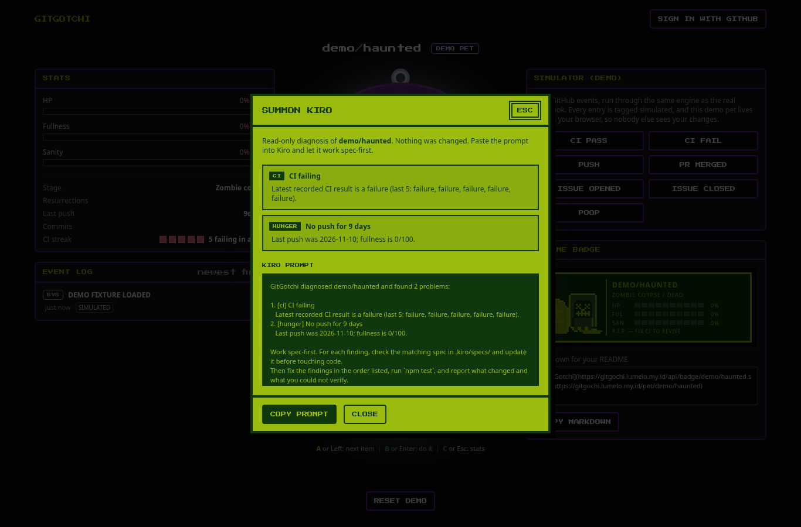
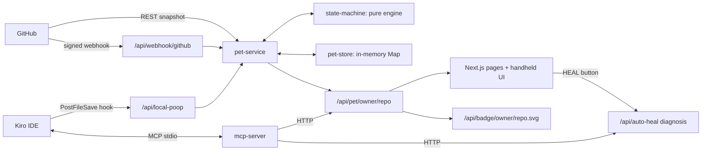

# GitGotchi: the Repo-Necromancer

GitGotchi is a 90s-style virtual pet whose health is the health of a GitHub repository. You adopt a public repo, and the pet reads its CI runs, pushes, merged pull requests and issues. Passing builds and fresh commits keep the pet well. Failing builds hurt it, and a repo that nobody pushes to starves it. A dead pet climbs out of the grave when the repo shows life again: a passing CI run, a new push or a closed issue.

**Kiroween 2026 entry, category Resurrection.** The handheld virtual pet of the late 90s returns as a live view of repo health, and the pet itself rises from the dead when its repo does.

- **Live app:** <https://gitgochi.lumelo.my.id/> (demo pet: <https://gitgochi.lumelo.my.id/pet/demo/healthy>)
- **Demo video:** not published yet. <!-- TODO(video): add the YouTube link here (video under 3 minutes) -->
- **Repository:** <https://github.com/Zee7X/gitgochi>
- **License:** MIT, see [LICENSE](LICENSE)

[](https://gitgochi.lumelo.my.id/pet/zee7x/gitgochi)

The project was built with Kiro. The `.kiro/` folder at the repository root holds the specs, hooks, steering files and MCP settings. See [How Kiro was used](#how-kiro-was-used) and [docs/KIRO_USAGE.md](docs/KIRO_USAGE.md).


## The problem

Failing CI runs and stale issues usually arrive as notifications, and people learn to tune them out. A repo can also go quiet for months before anyone notices that it has been abandoned.

GitGotchi shows that state as a pet. A sick or dead pet on the project page, or in the README badge, is harder to ignore than another email. The REVIVE button does not help either: the server answers `FIX CI FIRST` until the latest CI run is green.

## What it does

- **Adopt any GitHub repo.** Type `owner/repo` or paste a GitHub URL. Public repos work without signing in; private repos work once the GitGotchi App is installed on them. The pet is seeded from the recent completed CI runs on the default branch, the commit count, the last push and the number of stale issues (open issues with no update for 30 days).
- **One pet per repo, cared for by its team.** Sign in with GitHub. Collaborators with push access (keepers) share the repo's pet and can feed, clean and revive it; everyone else can only look. A private repo's pet is visible only to people with access to the repo.
- **Live updates.** Installing the GitGotchi App on a repo feeds the pet from pushes, completed check runs or workflow runs, merged pull requests and issues, with no secret to copy. Without it, the app re-reads GitHub on the first request after its 5-minute cache expires. The pet page polls every 15 seconds, slowing to 2 minutes while nothing changes, and only while the tab is visible.
- **Pixel-art handheld.** A translucent purple shell holds a 4-shade green LCD with buttons A, B and C. The pet has four stages: `EGG`, `BABY_GHOST`, `CODE_DEMON` and `ZOMBIE_CORPSE`. All sound is synthesized with the Web Audio API, and the repo contains no audio files.
- **Live README badge.** `/api/badge/{owner}/{repo}` returns an SVG of the pet with no scripts and no external fonts or images.
- **Kiro integration.** A hook makes the pet poop when a saved file under `src/` contains `console.log`, `debugger`, `TODO:` or `FIXME`. An MCP server answers questions about the pet from Kiro chat. **Summon Kiro** builds a read-only diagnosis of what is wrong with the repo and a prompt that Kiro can act on.
- **Labelled demo data.** Demo pets carry a `DEMO PET` tag, and every simulated event is tagged `simulated`. Each browser keeps its own demo pets, so nobody sees what others clicked. The app never opens pull requests and never claims a fix it did not make.
- **Privacy.** Only stats, counts and event labels are stored, never code, commit messages, emails or issue titles. Private pets are encrypted before they reach the store. Details on [`/privacy`](https://gitgochi.lumelo.my.id/privacy).

| Dead pet on `/pet/demo/haunted` | Summon Kiro diagnosis | Badge SVGs from `/api/badge` |
|---|---|---|
|  |  |  |

## Quick start

Requirements: Node.js 22 or newer.

```bash
git clone https://github.com/Zee7X/gitgochi.git
cd gitgochi
npm install
cp .env.example .env.local   # optional for the demo pets
npm run dev
```

Open `http://localhost:3000`. The handheld on the home page shows `demo/healthy`. To adopt a real repo, type `owner/repo` or paste a GitHub URL into the adopt form. The app then opens `/pet/{owner}/{repo}`.

> **Set `GITHUB_TOKEN` before adopting real repos.** Without a token, GitHub allows 60 requests per hour per IP, and one repo snapshot costs 4 requests. When the quota runs out, the API answers `github rate limit reached` (HTTP 503). A fine-grained token with read-only access to public repositories and no extra permissions raises the limit to 5000 requests per hour. Put it in `.env.local`. Demo repos never call GitHub.

### Controls

| Button | Key | Action |
|---|---|---|
| A | Left arrow | Next menu item |
| B | Enter | Run the selected item |
| C | Esc | Show or hide stats |

A living pet has the menu `FEED`, `CLEAN`, `HEAL`, `STATS`. A dead pet has `REVIVE` and `HEAL`. On a real repo, `FEED`, `CLEAN`, `REVIVE` and SYNC NOW need a keeper; visitors get a hint to sign in.

## Demo pets

Demo repos (`demo/<name>`) are built from fixtures in `src/lib/demo-fixtures.ts`. They never call GitHub, and their state lives in your browser's `localStorage`, not on the server, so your clicks never reach anyone else. The simulator panel sends labelled fake events (CI pass, CI fail, push, PR merged, issue opened, issue closed, poop) through the same rules as the server (`src/lib/pet-logic.ts` on top of `src/lib/state-machine.ts`). RESET DEMO reloads the fixture. The demo badge always shows the fixture.

| Page | Fixture | Result |
|---|---|---|
| `/pet/demo/healthy` | 5 passing CI runs, last push 2 hours ago | `CODE_DEMON`, happy |
| `/pet/demo/neglected` | 3 failing runs in a row, last push 80 hours ago, 6 stale issues | `BABY_GHOST`, sick |
| `/pet/demo/haunted` | 5 failing runs in a row, last push 9 days ago, 12 stale issues | `ZOMBIE_CORPSE` |

## How the pet works

The rules are in `src/lib/state-machine.ts` and specified in `.kiro/specs/pet-engine/`. HP, Fullness and Sanity are integers from 0 to 100.

| Trigger | Effect |
|---|---|
| Push | +5 Fullness per commit, at most +20 per push |
| CI run completed | `success`: +15 HP. `failure`: -25 HP |
| Pull request merged | +20 Fullness, +10 HP, +10 Sanity, party mood for 1 hour |
| Issue opened / closed | -5 / +10 Sanity |
| Code smell reported by the Kiro hook | +1 poop (at most 5), -10 Sanity |
| FEED | +10 Fullness, at most 3 times per hour |
| CLEAN | Removes all poop, +12 Sanity per poop removed |
| Time | -1 Fullness per hour. While any poop is on screen, -5 HP at each UTC midnight |

Stages:

- `EGG`: fewer than 5 commits, and the pet has never been resurrected.
- `CODE_DEMON`: HP at least 80, Sanity at least 70, Fullness at least 50, no failure in the last 3 CI results, and not rising (see below).
- `BABY_GHOST`: every other living pet.
- `ZOMBIE_CORPSE`: HP 0, or Fullness 0 with the last push 30 or more days ago.

A pet back from the dead is **rising**: it stays a `BABY_GHOST`, whatever its stats, until 24 hours have passed **and** a new push or a green CI run arrived after it came back. The stats card shows what is still missing. This keeps a revived repo from jumping straight to `CODE_DEMON` on the first resync.

A dead pet ignores every event except a passing CI run, a closed issue or a push. Any of those brings it back with 50 HP, 50 Fullness and 60 Sanity. The REVIVE button does the same, but only when the latest recorded CI result is a success. Otherwise the server answers HTTP 409 and the LCD shows `FIX CI FIRST`.

When a real repo is seeded, HP starts at 100 and replays the fetched CI runs (+15 or -25 each). A repo with no runs starts at 85 HP. Fullness is 100 minus the hours since the last push. Sanity drops by 10 per stale issue, counting at most 10 issues.

## Environment variables

Copy [`.env.example`](.env.example) to `.env.local`. All variables are optional for the demo pets.

| Variable | Used by | Purpose |
|---|---|---|
| `GITHUB_TOKEN` | `src/lib/github.ts`, `src/lib/heal.ts` | Quota for visitors who are not signed in. Required for a deployed instance. Never used to show a private repo to an outsider |
| `GITHUB_WEBHOOK_SECRET` | `src/app/api/webhook/github/route.ts` | Manual repo webhook (older setups). When empty, unsigned requests are accepted |
| `GITHUB_APP_ID`, `GITHUB_APP_SLUG`, `GITHUB_APP_CLIENT_ID`, `GITHUB_APP_CLIENT_SECRET`, `GITHUB_APP_PRIVATE_KEY`, `GITHUB_APP_WEBHOOK_SECRET` | `src/lib/github-app.ts`, `src/lib/session.ts`, `/api/github-app/webhook` | The GitGotchi App: sign in, keepers, private repos, live webhooks. Without them, pets are public and read-only |
| `SESSION_SECRET` | `src/lib/session.ts` | Encrypts sessions and user tokens |
| `DATA_ENCRYPTION_KEY` | `src/lib/pet-store.ts` | Encrypts private pets before they reach the store |
| `APP_ORIGIN` | `src/lib/auth-flow.ts`, `src/lib/access.ts` | Public origin, for the sign-in callback and the same-origin check on writes |
| `SETUP_TOKEN` | `/setup/github-app` | Unlocks the one-time app registration page. Remove it afterwards |
| `GITGOTCHI_URL` | `scripts/poop-detector.mjs`, `mcp-server/index.mjs` | App URL for the hook and the MCP server (default `http://localhost:3000`) |
| `GITGOTCHI_REPO` | `scripts/poop-detector.mjs`, `src/app/api/local-poop/route.ts` | Repo key the hook reports to (default: the git `origin`, then `demo/healthy`) |
| `GITGOTCHI_HOOK_TOKEN` | `scripts/poop-detector.mjs`, `mcp-server/index.mjs`, `src/app/api/local-poop/route.ts` | A per-pet hook token from KEEPER TOOLS (`ggh_...`), or, on your own server, a deployment-wide token |

## Sign in, keepers and live updates

1. Click **SIGN IN WITH GITHUB**. GitGotchi asks GitHub who you are; it gets no write access to anything.
2. Open a repo's pet. If you have push, maintain or admin access, you are a **keeper**: FEED, CLEAN, REVIVE, SYNC NOW and KEEPER TOOLS work for you. Everyone else can look.
3. For live updates, and for any private repo, an admin of the repo clicks **INSTALL GITGOTCHI** (KEEPER TOOLS or **MY PETS**) and picks the repos. The app has read-only access to metadata, contents, actions, checks, issues and pull requests, and receives pushes, CI runs, pull requests and issues for those repos.
4. **MY PETS** (`/me`) lists every installed repo you can access, labelled KEEPER or READER and PUBLIC or PRIVATE.

Once you are signed in, the home page is yours: the handheld shows your first pet, **YOUR PETS** lists the others with stage and HP, and the demo pets move to a small **TRY A DEMO PET** section at the bottom. **LOOK UP ANY REPO** (the adopt form) still opens the pet of any public repo, yours or someone else's, without installing anything; you can care for it if you have push access. Visitors who are not signed in see the demo pet and **ADOPT YOUR REPO** instead.

KEEPER TOOLS on the pet page also hold:

- **Private badge:** a private repo's badge needs a key in its URL. MAKE BADGE LINK shows the markdown once; making a new one kills the old link.
- **Kiro hook and MCP token:** NEW TOKEN shows `GITGOTCHI_URL`, `GITGOTCHI_REPO` and `GITGOTCHI_HOOK_TOKEN` once. Put them in `.env.local` where Kiro runs; the token only works for that pet. Up to 5 per pet, each revocable.
- **DELETE PET:** removes stats, history, badge key and tokens.

A manual webhook (`POST /api/webhook/github`, signed with `GITHUB_WEBHOOK_SECRET`) still works for repos set up that way, but new repos should install the app.

## Badge

To show a pet in a README:

1. Open the pet page, for example `https://gitgochi.lumelo.my.id/pet/owner/repo`.
2. In **README BADGE**, press **COPY MARKDOWN**.
3. Paste it into the repo's `README.md`, commit and push. GitHub shows it through its image proxy and picks up changes within a few minutes (the pet is re-read from GitHub every 5 minutes, the badge image is cached for 2).

Full badge (360x120):

```markdown
[](https://gitgochi.lumelo.my.id/pet/owner/repo)
```

Small badge (220x40), which fits next to shields.io badges in one row:

```markdown
[](https://gitgochi.lumelo.my.id/pet/owner/repo)
```

`?static=1` turns off the idle bob. A dead pet is drawn as a tombstone: `R.I.P. - FIX CI TO REVIVE` when red CI killed it, `R.I.P. - PUSH CODE TO REVIVE` when it starved (no push for 30 days). Responses carry an `ETag` and are cached for 120 seconds (60 on the CDN). A private repo's badge needs `?k=<badge key>` from KEEPER TOOLS (MAKE BADGE LINK) and is never cached by the CDN; without the key it answers like a missing repo. Locally the badge is at `http://localhost:3000/api/badge/demo/healthy`.

## How Kiro was used

The `.kiro/` folder is at the repository root and is committed. The full write-up is in [docs/KIRO_USAGE.md](docs/KIRO_USAGE.md).

| Kiro feature | Where | What it does |
|---|---|---|
| Specs | `.kiro/specs/{pet-engine,github-sync,kiro-healer,haunted-ui}/` | One `requirements.md` (EARS), `design.md` and `tasks.md` per feature. `.kiro/specs/gitgotchi-prd.md` is the product document, and `.kiro/specs/kiroween-submission/` plans the remaining submission work |
| Hooks | `.kiro/hooks/poop-detector.json` | On save of a `.ts` or `.tsx` file under `src/`, runs `scripts/poop-detector.mjs`. The script scans for `console.log`, `debugger`, `TODO:` and `FIXME` and reports to `/api/local-poop`. A smell makes the pet poop. Saving the same file clean runs CLEAN on the pet. If the app is down, the script prints one line and exits 0 |
| | `.kiro/hooks/spec-sync.json` | On save of `src/lib/state-machine.ts`, asks the agent to check the change against `.kiro/specs/pet-engine/` and run `npm test` |
| Steering | `.kiro/steering/` | `retro-aesthetic.md` (palette, pixel font, shell), `architecture.md` (stack and project layout), `kiro-integration.md` (how the pieces connect, and the rule to report only real results), `summon-healer.md` (manual, run as `/summon-healer`) |
| MCP server | `mcp-server/index.mjs`, `.kiro/settings/mcp.json` | stdio server `gitgotchi` with `get_pet_status`, `diagnose_pet`, `feed_pet`, `clean_pet`, `simulate_event` (demo repos only), `adopt_pet` and `add_badge` (writes the badge into the workspace README; you commit). The other tools call the running app over HTTP. Only the two read-only tools are auto-approved |
| Property-based tests | `src/lib/__tests__/state-machine.test.ts` | `fast-check` properties P1 to P6 run the engine over random event sequences and time gaps. The pet-engine requirements name the property that checks each rule |

**Summon Kiro** runs from HEAL on the handheld, from `diagnose_pet` over MCP, or from `/summon-healer` in Kiro chat. It reports the latest completed CI run if that run failed (with its link), up to 3 stale issues, up to 5 code smells reported by the hook, and the days since the last push when there has been no push for 2 days or more. It returns those findings and a prompt. Kiro then fixes the code in your workspace and runs `npm test`. GitGotchi does not open pull requests and does not edit files.

To use the hook and the MCP server, open this folder in Kiro and run `npm run dev`. Open the app once in the browser before editing. The hook script waits at most 3 seconds for the app, so a call against a cold dev server can time out.

## Architecture



Stack: Next.js 16 (App Router), React 19, TypeScript, Tailwind CSS, `@modelcontextprotocol/sdk`, Vitest and fast-check. The engine in `src/lib/state-machine.ts` is pure functions. `src/lib/pet-service.ts` handles GitHub snapshots, demo fixtures and user actions. More detail is in `.kiro/steering/architecture.md`.

## Testing

```bash
npm test          # vitest: engine with property-based tests, GitHub sync, webhook, badge, heal, hook route, repo parsing, Power
npx tsc --noEmit  # type check
npm run lint      # eslint on the whole repository, 0 warnings allowed
npm run build     # production build
npm run test:e2e  # Playwright: builds, starts on port 3100, checks layout at 390 px and 1280 px, keyboard use, clean console
```

`npm run test:e2e` needs Chromium once: `npx playwright install chromium`.

## Known limits

- **Without a KV store, pets live in memory.** When neither the `UPSTASH_REDIS_REST_*` nor the `KV_REST_API_*` pair is set, `src/lib/pet-store.ts` keeps pets in a `Map` in the server process, and a restart, redeploy or serverless cold start loses poop, the resurrection count and webhook effects. Set a KV pair in production (see [docs/DEPLOY.md](docs/DEPLOY.md)).
- **Resync replaces webhook effects.** Once the 5-minute cache has expired, the next request re-seeds a real repo's stats from GitHub. Effects the snapshot does not count, such as the bonus from a merged pull request, are replaced at that point. Poop and the resurrection count are kept. Webhooks that arrive before the first snapshot are replayed once onto it.
- **Per-file poop has a window.** Cleaning a file removes only that file's poop, but only while its poop event is among the 50 logged events. Poop is capped at 5; the CLEAN button always clears everything.
- **The operator can read what is stored.** Private pets are encrypted against a leaked copy of the store, but whoever runs the deployment holds the keys and sees repo names in request logs. `/privacy` says so.
- **Installing needs a repo admin.** A collaborator with push access can keep a public repo's pet after signing in, but a private repo needs an admin to install the GitGotchi App once.
- **Read-only, always.** The app reads from GitHub and never writes to it.

## Docs

- [docs/KIRO_USAGE.md](docs/KIRO_USAGE.md): how Kiro was used
- [docs/DEPLOY.md](docs/DEPLOY.md): Vercel, environment variables, webhook
- [docs/DEMO_SCRIPT.md](docs/DEMO_SCRIPT.md): script for the demo video

## License

MIT License, Copyright (c) 2026 Rizick. See [LICENSE](LICENSE).
