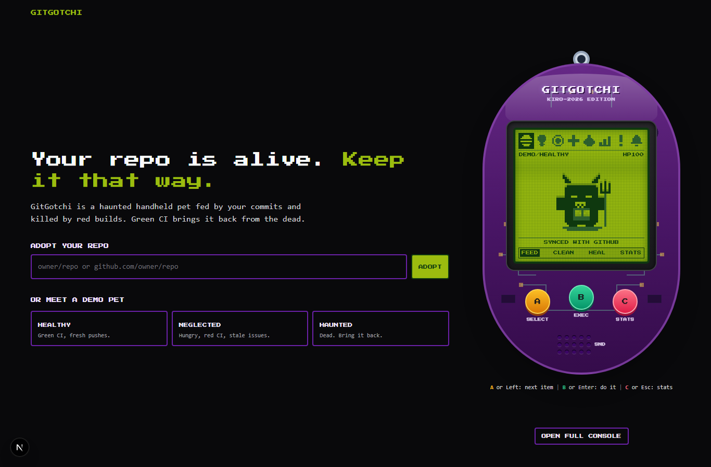
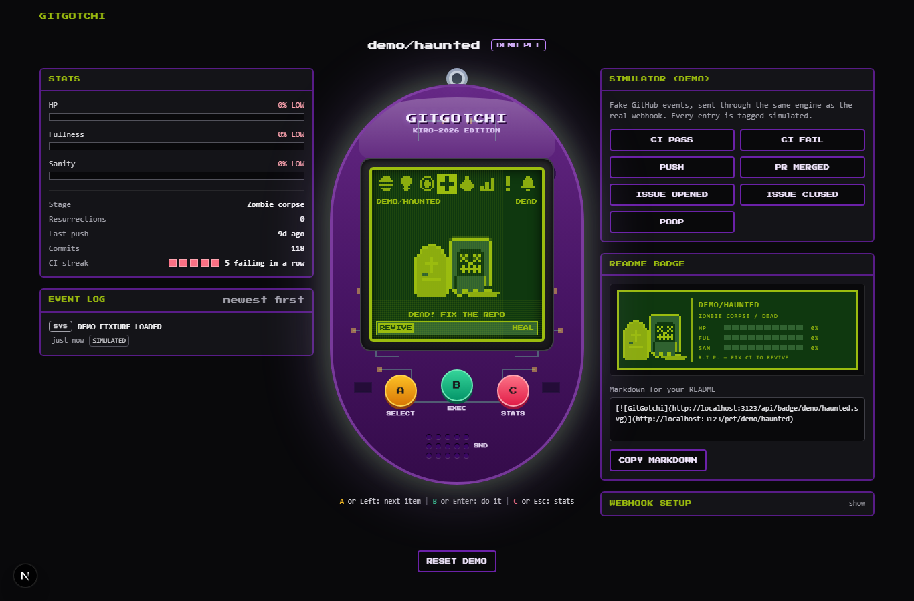
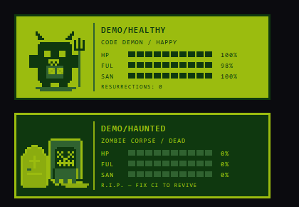

# GitGotchi: the Repo-Necromancer

A 90s virtual pet whose health is your repository's health. Green CI feeds it. Red CI hurts it. Neglect kills it. Fix the build and it climbs out of the grave.

> **Kiroween 2026 entry.** Category: **Resurrection** (the 90s virtual pet, brought back as a live view of repo health). Bonus: **Costume Contest** (retro-spooky 8-bit handheld).
> Built with [Kiro](https://kiro.dev): specs, hooks, steering and an MCP server. How: [`docs/KIRO_USAGE.md`](docs/KIRO_USAGE.md).
> License: MIT.

[](https://YOUR-DEPLOYMENT.vercel.app/pet/demo/healthy)

<!-- The badge above points at the deployed app. Replace YOUR-DEPLOYMENT once deployed (docs/DEPLOY.md). Locally: http://localhost:3000/api/badge/demo/healthy -->



## Why

- **Alert fatigue.** Failing CI, stale issues and lint noise arrive as text and get ignored. A pet that is visibly dying is harder to ignore.
- **Abandoned repos.** A repo can rot for months before anyone notices. GitGotchi starves a pet that has no pushes and kills it after 30 days.
- **Resurrection.** The virtual pet of the 90s is back, and it can only be revived by fixing the repo: the Revive button answers `FIX CI FIRST` until the latest CI run is green.

## What it does

- **Adopt any public GitHub repo.** The pet is seeded from the repo's real CI runs, commit count, last push and stale issues.
- **Live updates.** A signed webhook feeds the pet from pushes, check runs, merged PRs and issues. Without webhooks the app re-reads GitHub on the first request after a 5-minute cache window.
- **Four stages.** `EGG`, `BABY_GHOST`, `CODE_DEMON`, `ZOMBIE_CORPSE`, drawn as pixel art on a 4-shade green LCD, with synthesized 8-bit sound (Web Audio, no audio files).
- **Live README badge.** `/api/badge/{owner}/{repo}` is an inline SVG that survives GitHub's image proxy.
- **Kiro integration.** A hook that makes the pet poop when Kiro saves a file with `console.log`, an MCP server to ask the pet questions from Kiro chat, and **Summon Kiro**: a read-only diagnosis of what is really wrong, with a prompt that makes Kiro fix it.
- **No fake data.** Demo pets and simulated events are labelled. The app never opens pull requests or claims fixes it did not make.

| Dead pet | Summon Kiro | README badge |
|---|---|---|
|  |  |  |

<!-- docs/media/hero.png, zombie.png, summon-kiro.png and badge.png are captured by the project owner before submission. -->

## Quick start

Requirements: Node.js 22 or newer.

```bash
git clone <this repository>
cd gitgotchi
npm install
cp .env.example .env.local   # optional for demo pets, see the note below
npm run dev
```

1. Open <http://localhost:3000>. The handheld on the home page is `demo/healthy`.
2. Try the demos: `/pet/demo/healthy`, `/pet/demo/neglected`, `/pet/demo/haunted`. On a demo repo the simulator panel can push, pass or fail CI, merge a PR and so on. Every simulated event is labelled `simulated`.
3. Adopt a real repo: type `owner/repo` (or paste a GitHub URL) in the adopt form. You land on `/pet/{owner}/{repo}`.

> **Set `GITHUB_TOKEN` for real repos.** Without it GitHub allows 60 requests per hour per IP and one adoption costs about 4, so you will see `github rate limit reached` (HTTP 503). Create a fine-grained token with public-repository read-only access and no scopes, and put it in `.env.local`. A deployed instance needs it (5000 requests/hour). Demo repos work without it.

Controls: **A** (or Left arrow) next menu item, **B** (or Enter) run it, **C** (or Esc) stats. Menus: alive `FEED / CLEAN / HEAL / STATS`, dead `REVIVE / HEAL`.

## Environment variables

Copy [`.env.example`](.env.example) to `.env.local`. All are optional for demo pets.

| Variable | Used by | Purpose |
|---|---|---|
| `GITHUB_TOKEN` | `src/lib/github.ts`, `src/lib/heal.ts` | GitHub API quota. Required for deployed instances |
| `GITHUB_WEBHOOK_SECRET` | `src/app/api/webhook/github/route.ts` | Verifies `X-Hub-Signature-256`. Unsigned requests are accepted when empty |
| `GITGOTCHI_URL` | `scripts/poop-detector.mjs`, `mcp-server/index.mjs` | App URL for the hook and the MCP server (default `http://localhost:3000`) |
| `GITGOTCHI_REPO` | `scripts/poop-detector.mjs`, `src/app/api/local-poop/route.ts` | Repo key the hook reports to (default: git `origin`, then `demo/healthy`) |
| `GITGOTCHI_HOOK_TOKEN` | `scripts/poop-detector.mjs`, `src/app/api/local-poop/route.ts` | Bearer token for non-local callers of `/api/local-poop` |

## Webhook setup

On the repo you adopted: **Settings, Webhooks, Add webhook**.

1. **Payload URL:** `https://<your-deployment>/api/webhook/github` (GitHub must be able to reach it, so use your deployed URL or a tunnel). The pet page shows this URL under WEBHOOK SETUP.
2. **Content type:** `application/json`.
3. **Secret:** any random string, and the same value in `GITHUB_WEBHOOK_SECRET` on the server.
4. **Events:** pushes, check runs (or workflow runs), pull requests, issues.

| GitHub event | Effect on the pet |
|---|---|
| `push` | Feeds it: +5 Fullness per commit, max +20 per push |
| `check_run` / `workflow_run` completed | `success` +15 HP, `failure` -25 HP. HP 0 kills the pet |
| `pull_request` closed and merged | +20 Fullness, +10 HP, +10 Sanity, party |
| `issues` opened / closed | -5 / +10 Sanity |

A dead pet resurrects on a CI success, a closed issue or a push.

## Badge

```markdown
[](https://YOUR-DEPLOYMENT.vercel.app/pet/owner/repo)
```

Options: `?size=small` (220x40) and `?static=1` (no animation). The pet page has a copy button for this snippet.

## Kiro: how it is used

Everything is in `.kiro/` and committed. Full write-up: [`docs/KIRO_USAGE.md`](docs/KIRO_USAGE.md).

| Kiro feature | Where | What it does |
|---|---|---|
| **Specs** | `.kiro/specs/{pet-engine,github-sync,kiro-healer,haunted-ui}/` | `requirements.md` (EARS), `design.md`, `tasks.md` per feature; `.kiro/specs/gitgotchi-prd.md` is the product doc |
| **Hooks** | `.kiro/hooks/poop-detector.json` | On file save under `src/`, `scripts/poop-detector.mjs` scans for `console.log`, `debugger`, `TODO:`, `FIXME` and tells the app: the pet poops. A clean save removes it |
| | `.kiro/hooks/spec-sync.json` | On save of `src/lib/state-machine.ts`, an agent compares code and spec and runs `npm test` |
| **Steering** | `.kiro/steering/` | `retro-aesthetic.md` (palette, pixel font), `architecture.md` (lean stack), `kiro-integration.md` (always on: never fabricate), `summon-healer.md` (manual, `/summon-healer`) |
| **MCP server** | `mcp-server/index.mjs`, `.kiro/settings/mcp.json` | Server `gitgotchi` with `get_pet_status`, `diagnose_pet`, `feed_pet`, `clean_pet`, `simulate_event` (demo repos only), `adopt_pet` |
| **Property-based tests** | `src/lib/__tests__/state-machine.test.ts` | `fast-check` properties P1 to P6 for the pet engine |

**Summon Kiro** (HEAL on the handheld, `diagnose_pet` over MCP, or `/summon-healer` in Kiro chat): reads the repo's real state (latest failed CI run, stale issues, code smells reported by the hook, days since the last push) and returns findings with real links plus a prompt. Kiro then fixes the code in your workspace and runs `npm test`. GitGotchi itself does not open PRs or edit anything.

To use the hook and the MCP server: open this folder in Kiro, run `npm run dev`, and **open the app once in the browser before editing** (the hook script gives up after 3 seconds, so the very first call against a cold dev server is skipped).

## Architecture

```mermaid
flowchart LR
  GH[GitHub] -->|REST snapshot| SVC
  GH -->|signed webhook| WH[/api/webhook/github]
  WH --> SVC[pet-service]
  SVC <--> ENG[state-machine: pure engine]
  SVC <--> STORE[pet-store: in-memory]
  SVC --> API[/api/pet/owner/repo]
  API --> UI[Next.js pages + handheld UI]
  API --> BADGE[/api/badge/owner/repo.svg]
  KIRO[Kiro IDE] -->|PostFileSave hook| LP[/api/local-poop]
  LP --> SVC
  KIRO <-->|MCP stdio| MCP[mcp-server]
  MCP -->|HTTP| API
  MCP -->|HTTP| HEAL[/api/auto-heal diagnosis]
  UI -->|HEAL button| HEAL
```

Stack: Next.js (App Router), React 19, TypeScript, Tailwind CSS, `@modelcontextprotocol/sdk`, Vitest and fast-check. Details: `.kiro/steering/architecture.md`.

**Known limit:** the pet store is in memory. A restart or a serverless cold start loses local state (poop, resurrection count, webhook effects); the next request re-seeds the pet from GitHub. A KV store is the next step, see [`docs/DEPLOY.md`](docs/DEPLOY.md).

## Testing

```bash
npm test          # vitest: engine (incl. property-based tests), GitHub sync, webhook, badge, heal, hook route
npx tsc --noEmit  # types
npm run lint      # eslint src
```

## Docs

- [`docs/KIRO_USAGE.md`](docs/KIRO_USAGE.md): how Kiro was used
- [`docs/DEPLOY.md`](docs/DEPLOY.md): Vercel, env vars, webhook
- [`docs/DEMO_SCRIPT.md`](docs/DEMO_SCRIPT.md): the 3-minute demo video script

## License

MIT, see [`LICENSE`](LICENSE).

---

## Ringkasan (Bahasa Indonesia)

GitGotchi adalah virtual pet retro ala 90-an yang nyawanya adalah kesehatan repositori GitHub Anda. CI hijau memberinya makan, CI merah melukainya, repo yang dibiarkan membuatnya mati menjadi zombie. Perbaiki build dan ia bangkit lagi. Ada badge SVG live untuk README, webhook GitHub, dan integrasi Kiro (hook, MCP server, steering, spec). Tombol **HEAL** hanya mendiagnosis masalah nyata dan memberi prompt untuk Kiro; ia tidak membuat PR sendiri. Mulai: `npm install`, `npm run dev`, buka <http://localhost:3000>. Isi `GITHUB_TOKEN` agar repo asli tidak terkena rate limit. Kategori: Kiroween 2026, Resurrection + Costume Contest.
