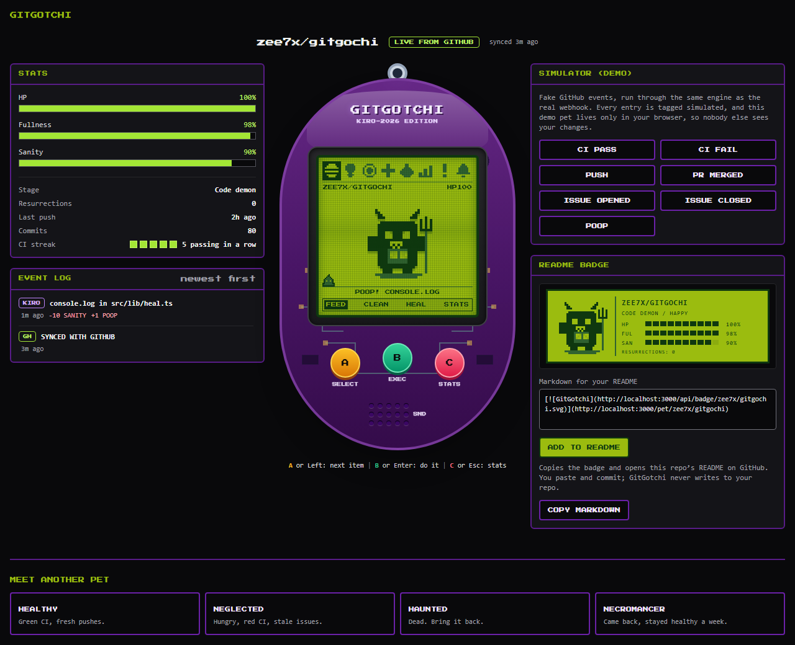
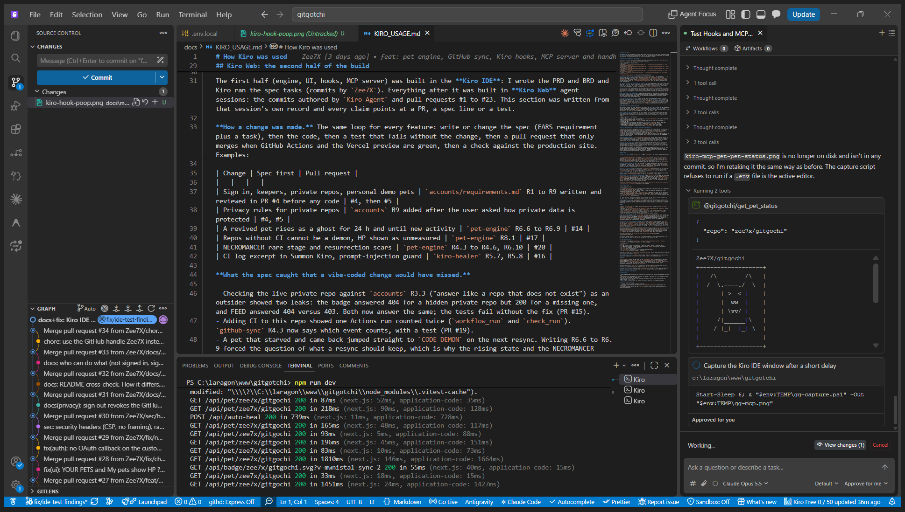

# How Kiro was used

The Devpost "How did you use Kiro?" write-up. Each answer points at files in this repo. Paragraphs marked **In my words** are my own first-hand account; the rest was checked against the repository, the tests and the production site. Where something was not used or not checked, it says so.

## Spec-driven development vs vibe coding

**What is in the repo.** Four feature specs in the layout Kiro's spec workflow uses (`requirements.md`, `design.md`, `tasks.md` per folder), plus the product document:

| Spec | Requirements | Design | Tasks |
|---|---|---|---|
| Pet engine | `.kiro/specs/pet-engine/requirements.md` | `.kiro/specs/pet-engine/design.md` | `.kiro/specs/pet-engine/tasks.md` |
| GitHub sync | `.kiro/specs/github-sync/requirements.md` | `.kiro/specs/github-sync/design.md` | `.kiro/specs/github-sync/tasks.md` |
| Kiro healer | `.kiro/specs/kiro-healer/requirements.md` | `.kiro/specs/kiro-healer/design.md` | `.kiro/specs/kiro-healer/tasks.md` |
| Haunted UI | `.kiro/specs/haunted-ui/requirements.md` | `.kiro/specs/haunted-ui/design.md` | `.kiro/specs/haunted-ui/tasks.md` |
| Accounts | `.kiro/specs/accounts/requirements.md` | `.kiro/specs/accounts/design.md` | `.kiro/specs/accounts/tasks.md` |

`.kiro/specs/gitgotchi-prd.md` is the product and business document.

**How the specs steer the code.** Requirements are written in EARS ("WHEN ... THE SYSTEM SHALL ...") and each one names the test that verifies it, for example `pet-engine/requirements.md` R6 points to properties P5 and P6 in `src/lib/__tests__/state-machine.test.ts`. The `spec-sync` hook (`.kiro/hooks/spec-sync.json`) asks Kiro to compare `src/lib/state-machine.ts` with `.kiro/specs/pet-engine/` every time the engine is saved, and `.kiro/steering/kiro-integration.md` tells the agent to change the spec first, then the code.

**A concrete case where the spec changed the product.** The first PRD promised an "Auto-Heal" button that would open a draft pull request. That had no honest implementation (the first version faked the result), so the PRD now says it is out of scope (`gitgotchi-prd.md` section 2.4) and the feature became Summon Kiro: a read-only diagnosis that hands Kiro a prompt (`kiro-healer/requirements.md` R5).

**In my words.** In the Kiro IDE my part was the product side: I wrote the PRD and the BRD (`.kiro/specs/gitgotchi-prd.md`), and Kiro turned them into the feature specs and then ran the tasks. The specs worked; the friction was the approvals. Running the tasks meant accepting many steps one by one, task after task, so a long task list turned into a lot of clicking. I did not take screenshots of the Specs panel at the time.

**Spec versus vibe in the second half.** In Kiro Web the requests were conversational ("make the demo pets private to each browser", "a revived pet should not jump straight to demon"), but every one of them was turned into a spec change before code, see the table under Kiro Web below. Conversation decided *what*; the spec pinned down the edge cases.

**In my words: approvals in the IDE.** Running the spec tasks meant approving one command at a time, which kept interrupting my work. What fixed it: switching the chat to **Approve for me** (commands then showed "Approved for you"), and **Always allow** with a narrow pattern for repeated commands. One thing stayed blocked on purpose: when the agent tried to edit `.kiro/settings/mcp.json`, Kiro refused it with the built-in `kiro-scope` rule (`deny fs_write .kiro/settings/`), so an agent cannot change its own MCP or permission settings. The agent did not try to work around it through the shell; I edit that file myself when needed.

## Kiro Web: the second half of the build

The first half (engine, UI, hooks, MCP server) was built in the **Kiro IDE**: I wrote the PRD and BRD and Kiro ran the spec tasks (commits by `Zee7X`). Everything after it was built in **Kiro Web** agent sessions: the commits authored by `Kiro Agent` and pull requests #1 to #23. This section was written from that session's own record and every claim points at a PR, a spec line or a test.

**How a change was made.** The same loop for every feature: write or change the spec (EARS requirement plus a task), then the code, then a test that fails without the change, then a pull request that only merges when GitHub Actions and the Vercel preview are green, then a check against the production site. Examples:

| Change | Spec first | Pull request |
|---|---|---|
| Sign in, keepers, private repos, personal demo pets | `accounts/requirements.md` R1 to R9 written and reviewed in PR #4 before any code | #4, then #5 |
| Privacy rules for private repos | `accounts` R9 added after the user asked how private data is protected | #4, #5 |
| A revived pet rises as a ghost for 24 h and until new activity | `pet-engine` R6.6 to R6.9 | #14 |
| Repos without CI cannot be a demon, HP shown as unmeasured | `pet-engine` R8.1 | #17 |
| NECROMANCER rare stage and resurrection scars | `pet-engine` R4.3 to R4.6, R6.10 | #20 |
| CI log excerpt in Summon Kiro, prompt-injection guard | `kiro-healer` R5.7, R5.8 | #16 |

**What the spec caught that a vibe-coded change would have missed.**

- Checking the live private repo against `accounts` R3.3 ("answer like a repo that does not exist") as an outsider showed two leaks: the badge answered 404 for a hidden private repo but 200 for a missing one, and FEED answered 404 versus 403. Both now answer the same; the tests fail without the fix (PR #15).
- Adding CI to this repo showed one Actions run counted twice (`workflow_run` and `check_run`). `github-sync` R4.3 now says which event counts, with a test (PR #19).
- A pet that starved and came back jumped straight to `CODE_DEMON` on the next resync. Writing R6.6 to R6.9 forced the question of what a resync should keep, which is why the rising state and the NECROMANCER streak now survive resyncs.

**Keeping the agent honest.** `.kiro/steering/kiro-integration.md` says to report only real results. In practice that meant: every "done" in a session came with the command output (tests, CI run, production `curl`, a browser check at 390 px and 1280 px), and things that could not be checked from the sandbox (signing in as the owner, Kiro IDE panels) were handed back to the owner instead of claimed.

**In my words: IDE versus Web.** I moved to Kiro Web because I wanted the agent to work directly with GitHub and Vercel so deployment would be fast, and that worked. In the IDE I had not set up those connections yet. Web felt faster to me and needed far fewer approvals: I gave a goal, and it came back with pull requests, a green CI run and a checked production site. I would use the IDE to shape the specs and Web to carry them through to a deployed app.

How the connections worked in Web: GitHub through Kiro Web's own GitHub connection (`git` and `gh` were already authenticated in the session), Vercel through its REST API with a token from the session's secrets. That is how the agent set environment variables, created and merged pull requests, added the custom domain and registered the GitGotchi GitHub App's credentials.

## Agent hooks

**Hooks in the repo** (schema `version: "v1"`, trigger `PostFileSave`, per <https://kiro.dev/docs/hooks/>):

- `.kiro/hooks/poop-detector.json`: on save of a `.ts`/`.tsx` file under `src/` runs `node scripts/poop-detector.mjs "{{filePath}}"`. The script scans for `console.log(`, `debugger`, `TODO:` and `FIXME`, then POSTs to `/api/local-poop` (`src/app/api/local-poop/route.ts`). A smell adds a poop to the pet (event source `kiro-hook`, label like `console.log in src/x.ts`); saving the file clean removes it. If the app is down the script prints one line and exits 0, so it never blocks Kiro.
- `.kiro/hooks/spec-sync.json`: an agent hook that checks the engine against its spec and runs `npm test`.

**What was verified outside the IDE.** The script was run by hand against a local dev server: a dirty file gave poop 1 with the label `console.log in src/...` and source `kiro-hook`, saving the same dirty file again did not count twice, a clean save returned 200, and a request with a spoofed `x-forwarded-for` got 403. The route is also covered by `src/lib/__tests__/local-poop.test.ts`.

**What was not verified.** That Kiro substitutes `{{filePath}}` as expected and which key the stdin JSON uses are not named in Kiro's docs; the script falls back to `KIRO_HOOK_FILE` and several stdin keys (`scripts/poop-detector.mjs`). The script gives up after 3 seconds, so the first save against a cold `next dev` is skipped: open the app once before editing.

**Design note.** Kiro v1 hooks have no manual trigger, so the on-demand "summon" entry point is a manual steering file (`.kiro/steering/summon-healer.md`, run as `/summon-healer`), not a hook.

**In my words: run in the Kiro IDE (19 November 2026).** With `npm run dev` on port 3000, the agent added `console.log('test')` to `src/lib/heal.ts` and saved it. The hook fired, the server logged `POST /api/local-poop 200`, and the pet showed poop 1 and Sanity 90 at once, with the event `console.log in src/lib/heal.ts` tagged KIRO. When the line was removed and saved again, the hook logged `clean after src/lib/heal.ts`: poop back to 0, Sanity 100. The file path arrived correctly; I did not check whether it came through `{{filePath}}`, stdin or an environment variable.

## Steering strategy

| File | Inclusion | Why |
|---|---|---|
| `.kiro/steering/retro-aesthetic.md` | default (always) | Keeps every UI change inside the 4-shade green LCD palette, the pixel font and the purple shell |
| `.kiro/steering/architecture.md` | default (always) | Keeps the stack lean (native first, no new dependencies) and documents the project tree |
| `.kiro/steering/kiro-integration.md` | `inclusion: always` | Documents how hooks, MCP and the API fit together and forbids fabricated results ("report only what a tool, test or command actually returned") |
| `.kiro/steering/summon-healer.md` | `inclusion: manual` | The `/summon-healer` workflow: diagnose, spec first, fix, `npm test`, report honestly |

The "never fabricate" rule exists because an early version of the heal feature invented PR numbers and fix lists. It is in steering so any agent working in the repo inherits it.

**Effect seen in Kiro Web.** `kiro-integration.md` mattered most: its "report only what actually ran" rule showed up as every result arriving with its evidence (test counts, CI run, production `curl`), and as the agent handing back what it could not check itself, such as signing in with my account, instead of claiming it.

## MCP

- Server: `mcp-server/index.mjs` (stdio, `@modelcontextprotocol/sdk`), started with `node mcp-server/index.mjs` or `npm run mcp`.
- Registered in `.kiro/settings/mcp.json` as `gitgotchi`, with `GITGOTCHI_URL` and `autoApprove` limited to the two read-only tools `get_pet_status` and `diagnose_pet`.
- Tools: `get_pet_status` (ASCII LCD of the pet), `diagnose_pet` (real findings plus a Kiro prompt), `feed_pet`, `clean_pet`, `simulate_event` (refuses anything but `demo/*`), `adopt_pet`, `add_badge` (writes the badge into the workspace README, never commits).
- Every tool is a thin HTTP call to the running app; the server computes nothing.

**What was verified outside the IDE.** `initialize` and `tools/list` return the seven tools (checked by `power.test.ts` on every test run), `get_pet_status` rendered the ASCII LCD, and `add_badge` was run over stdio against a copy of a real README: it joined the badge row, changed nothing on a second run and refused a path outside the workspace. `diagnose_pet` and the GitHub calls behind it are covered by `src/lib/__tests__/heal.test.ts` with a mocked `fetch`; they were not run against live GitHub (the unauthenticated quota was exhausted during development).

**In my words: run in the Kiro IDE (19 November 2026).** The `gitgotchi` server connected from `.kiro/settings/mcp.json`. `get_pet_status` and `diagnose_pet` ran without an approval prompt, because they are the two tools in `autoApprove`. In the `/summon-healer` flow, `diagnose_pet` found one problem, `[poop] console.log in src/lib/heal.ts`; no spec change was needed; the agent removed the line, the hook cleaned the poop, and the next `diagnose_pet` answered "No findings". `npm test` then passed 321 of 322; the one failure is described below.

What went wrong first: my port 3000 was taken by another dev server, so the first `get_pet_status` failed with `Cannot read properties of undefined (reading 'stage')`. The MCP server now says plainly when something other than GitGotchi answers on `GITGOTCHI_URL`. The failing test was `power.test.ts`: with `core.autocrlf=true` on Windows the checkout had CRLF line endings and the frontmatter regex expected `\n`. The test now normalises line endings, and `.gitattributes` keeps LF in every checkout.

Also checked outside the IDE: `/api/auto-heal` on production against a public repo whose latest CI run had failed named the failed job and step and returned the error lines of the log.

## Property-based testing

The pet engine is tested with `fast-check` (`src/lib/__tests__/state-machine.test.ts`, `describe('properties')`) over random event sequences and random time gaps:

| Id | Property |
|---|---|
| P1 | HP, Fullness, Sanity stay integers in 0..100, poop in 0..5, at most 5 CI results kept |
| P2 | HP 0 implies zombie; a zombie with HP above 0 starved; `diedAt` is set exactly when zombie |
| P3 | `tick` is idempotent for the same `now` |
| P4 | `tick` never raises Fullness |
| P5 | `resurrections` grows only by 1 and only when the pet was dead |
| P6 | the `revive` action never changes a living pet |

These are referenced from `.kiro/specs/pet-engine/requirements.md` so each requirement names the property that checks it. Run them with `npm test`.

**Correctness view not used.** I did not open the specs in Kiro's Correctness view. The properties above were written by hand with `fast-check` and run on every `npm test` and in GitHub Actions.

## Powers

`power-gitgotchi/` packages the MCP server and the `summon-healer` skill as a Kiro Power in the Agent Plugins 1.0.0 format (`plugin.json`, `mcp.json`, `skills/summon-healer/SKILL.md`). The server is a single-file bundle (`npm run build:power`) because an imported Power has no `node_modules` and `mcp.json` may only use a `cwd` inside the Power folder. Hooks are not part of the Power format, so the poop-detector and spec-sync hooks stay in `.kiro/hooks/`.

Checked outside the IDE: `power.test.ts` validates both manifests against the schema fields and starts the bundle over stdio, which lists the same seven tools as `mcp-server/index.mjs`.

**Not imported in the IDE.** I did not import `power-gitgotchi/` through the Powers panel, so activation by keyword is not confirmed. The same server ran from the workspace config, as described under MCP.

## What I would tell another builder

**In my words.**

- Write the PRD and BRD yourself and let Kiro turn them into specs: that part was fast and kept the scope clear.
- Long task lists in the IDE mean many approvals, one task at a time. Plan for it, or hand the run to an agent that can work through the whole list.
- Connect GitHub and your hosting early. Deploying through Kiro Web with those connections was the biggest speed-up of the project.
- Keep a "report only what really ran" rule in steering: it made every status update checkable.

## Checklist before submitting

- [x] Every `TODO(user)` above is answered or deleted
- [ ] Optional: a screenshot of the Specs panel (`docs/media/kiro-specs.png`), taken now from the finished specs
- [x] Claims re-checked against the repo: `npm test` green in GitHub Actions; IDE-only features are marked as not exercised
